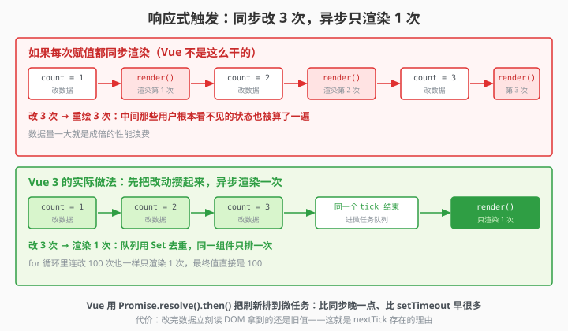

# 3.7 响应式触发：为啥改了不立即变

> 章节：第 3 章 响应式数据
> 课时：0.5 课时

---

## 🎯 学习目标

学完这节，你将能够：

- ✅ **理解**：Vue 为什么"攒一批再更新"（异步批量更新机制）
- ✅ **理解**：microtask 和"同步陷阱"——`console.log` 骗了你
- ✅ **掌握**：如何在数据变化后拿到最新的 DOM 值
- ✅ **避坑**：for 循环里多次改 ref，组件只会渲染一次

---

## 🧠 思维导图

```text
3.7 响应式触发：为啥改了不立即变
├── 核心机制：异步批量更新
│   ├── 同步改数据，异步更新 DOM
│   ├── 一次事件循环里多次修改 → 合并成一次渲染
│   └── 目的：避免不必要的重复渲染
├── 为什么 console.log 骗了你
│   ├── 你写的是同步代码
│   ├── DOM 更新是异步的
│   └── 所以 console.log 读到的还是旧 DOM
├── Vue 内部实现
│   ├── 维护一个更新队列（queue）
│   ├── 用 Promise.then / nextTick 调度
│   └── 同一个组件在队列里只存一次（去重）
└── 什么时候需要注意
    ├── 改了数据立刻读 DOM → 读到的还是旧的
    ├── for 循环改 100 次 ref → 只渲染一次
    └── watch 里监听 ref 变化 → 异步触发
```

"改了不立即变"是新手最容易怀疑人生的时刻：`count.value = 1` 刚执行完，立刻读页面文本还是旧的 0；循环连改 100 次 `ref`，页面只刷新一次。这不是 Bug，而是 Vue 故意的：它把更新攒起来、异步批量执行，避免改三个数据就重绘三次。本节讲透响应式更新的触发时机和批量机制。

---

## 🤔 一、一个让人困惑的现象

试试这段代码：

```vue
<script setup>
import { ref } from 'vue'

const count = ref(0)

function test() {
  count.value = 100
  console.log(count.value)           // 100（数据确实改了）
  // 但此时页面上 {{ count }} 显示的还是旧值！
}
</script>
```

你已经 `count.value = 100` 了，`console.log` 也输出 `100` 了——**但页面上还没变**。

别慌，这不是 bug，这是 Vue 的**异步批量更新机制**。

> 🎯 **类比一下：取件码和包裹**
>
> 你在网上下单，**取件码**常常秒到手机，但**包裹**还得等物流慢慢过来。
> `count.value = 100` 就是取件码到了——数据确实已经改了；页面上那个数字是包裹，还在路上。
> 你拿着取件码去驿站问"我的包裹呢"，驿站只能说：**再等等**。这不是驿站丢了件，只是它还没到。

---




## 💡 二、Vue 的"攒一波再更新"策略

### 2.1 为什么要异步？

假设你写了这样一段代码：

```js
count.value = 1
name.value = '张三'
age.value = 25
```

如果每改一个 ref 就立刻重新渲染一次组件，上面 3 行代码就会触发 **3 次渲染**——而用户只需要看到最终结果。

Vue 的做法是：**不是每次赋值都更新 DOM，而是把更新任务放进一个队列里，在本轮事件循环的末尾统一执行一次**。

```text
同步代码执行：
  count.value = 1    → 加入更新队列
  name.value = '张三' → 加入更新队列（同一个组件去重）
  age.value = 25     → 加入更新队列（同一个组件去重）
  ... 其他同步代码 ...

本轮事件循环微任务阶段：
  执行队列里的更新 → 只渲染 1 次 ✨
```

> 🎬 **小剧场：小新在奶茶店连点 100 杯**
>
> **小新**：一杯、一杯、一杯……（连喊 100 声）
> **店员（Vue君）**：都记在**同一张单**上了，后厨只出一次餐。
> **小新**：可我每喊一声都盯着出餐口，怎么一杯都没出？
> **Vue君**：因为要等你**这一轮全喊完**才开火。想第一时间知道"出杯了"，得用 `nextTick` 催单。
> **小新**：那我喊完立刻去看出餐口，看到的是空盘子——它也不报错？
> **Vue君**：对，它只会安安静静地把你误导。这就是下面 `console.log` 骗你的原因。

### 2.2 实际验证：for 循环改 100 次

```vue
<script setup>
import { ref } from 'vue'

const count = ref(0)

function hundredTimes() {
  for (let i = 0; i < 100; i++) {
    count.value++
  }
  // 页面只会渲染一次，display 直接显示 100
}
</script>

<template>
  <p>count: {{ count }}</p>
  <button @click="hundredTimes">+100</button>
</template>
```

你循环里改了 100 次，Vue 只渲染一次——因为 100 次修改都在同一个同步代码块里，被合并了。

---

## 🛠 三、为什么 console.log 骗了你

回到开头的问题：

```js
count.value = 100
console.log(document.getElementById('display').textContent)
// 输出的还是旧值！因为 DOM 还没更新
```

`console.log` 是同步的，它在你改 `count.value` 之后**立即执行**——但此时 DOM 更新任务还躺在队列里睡觉。

正确的读 DOM 方式 → 用 `nextTick`（下节详细讲）：

```js
import { nextTick } from 'vue'

count.value = 100
await nextTick()
console.log(document.getElementById('display').textContent)  // 拿到的是 "100" ✅
```

> 📦 **ES6 小灶：`Promise` 与 `async` / `await`**
>
> 一句话：`Promise` 是 ES6 表示"**以后才会有结果**"的对象；`async` / `await` 让我们像写同步代码那样等它。
>
>     async function run() {
>       const data = await fetch('/api/user')   // 等结果回来，再往下走
>       console.log(data)
>     }
>     run()   // 函数内部在等，整体并不阻塞
>
> ⚠️ 翻车例：`await` 只能出现在 `async` 函数里，或模块 / `<script setup>` 的最外层（就是你上面看到的写法）。写在普通函数里却漏了 `async`，会直接语法报错 `Uncaught SyntaxError: await is only valid in async functions`。
> 人话翻译：`await` = "**到号了再叫我**"。Vue 的 DOM 更新也在排队，`await nextTick()` 就是站到队伍末尾等它叫号；第四节那个 `Promise.resolve().then(flushJobs)`，正是这套排号机制在干活。

---

## 🔬 四、Vue 内部怎么做到的？

Vue 3 的内部用了一个叫"调度器（Scheduler）"的模块。简化版逻辑：

```js
// Vue 内部伪代码，不是真实源码，但逻辑一致
const queue = new Set()          // 待更新的组件集合（Set 自动去重）
let isFlushing = false           // 是否正在刷新队列

function queueJob(job) {
  queue.add(job)                 // 加入去重队列
  if (!isFlushing) {
    isFlushing = true
    Promise.resolve().then(flushJobs)  // 在本轮微任务里执行
  }
}

function flushJobs() {
  queue.forEach(job => job())    // 依次执行更新
  queue.clear()
  isFlushing = false
}
```

关键点：
- **用 `Set` 去重**：同一个组件无论触发多少次，队列里只存一份
- **用 `Promise.resolve().then()`** 调度到微任务：比 `setTimeout` 更早执行，但又晚于当前同步代码
- **`isFlushing` 锁**：防止重复刷新

> 💬 **老师备注**：Vue 2 用的是 `Promise`（优先）+ `MutationObserver` + `setTimeout` 的降级方案；Vue 3 直接用了 `Promise.resolve().then()`——因为现代浏览器都支持了。

---

## ⚠️ 五、常见陷阱

### 陷阱 1：在同一个函数里"改完立刻读 DOM"

```js
function changeAndRead() {
  count.value = 999
  const el = document.querySelector('#counter')
  console.log(el.textContent)  // ❌ 还是旧值
}
```

### 陷阱 2：认为改了数据页面会"同步闪烁"

```js
count.value = 1
// 期望：页面先显示 1
count.value = 2
// 期望：页面再显示 2

// 实际：页面直接显示 2，中间的 1 被跳过了
```

### 陷阱 3：watch 的回调也是异步触发的

```js
watch(count, (newVal) => {
  // 这个回调也是异步的——在 DOM 更新前执行
  // 想拿到最新的 DOM？—— 需要 nextTick（下节讲）
})
```

---

## 🧠 本节小结

- **更新是异步批量**：改数据后 DOM 不会立刻变，Vue 把同一轮改动攒起来一起渲染
- **为什么批量**：一次改多个数据只触发一次渲染，避免重复渲染浪费性能
- **触发时机**：数据变更 → 调度器排队 → 微任务里统一 flush → DOM 更新
- **别在改完立刻读 DOM**：读到的是旧值；要拿最新 DOM 用 `nextTick`（3.8 讲）
- **for 循环连改多次**：也只触发一次渲染，这是正常现象不是 Bug

---

## 📝 即时练习

**练习 1**：写一个计数器，按钮点击后用 `for` 循环把 `count.value` 加 10000 次。在按钮里加一个 `alert`，观察 alert 弹出时页面上是否已经显示了最新值。

**练习 2**：在 `count.value = 100` 之后立刻用 `document.querySelector` 读取 DOM 元素内容，对比 `console.log(count.value)` 和 DOM 内容——验证两者不同步的现象。

**练习 3**：写一个函数，连续改 3 个不同的 ref，用 `console.log` 在每行赋值后打时间戳，思考它们是否在同一轮微任务里。

---

## 📚 拓展阅读

- [Vue 3 官方文档 - 深入响应式系统 - 异步更新队列](https://cn.vuejs.org/guide/extras/reactivity-in-depth.html)
- [JavaScript 事件循环 - MDN](https://developer.mozilla.org/zh-CN/docs/Web/JavaScript/Event_loop)

---

**（3.7 节结束，下一节 3.8 讲 nextTick →）**
