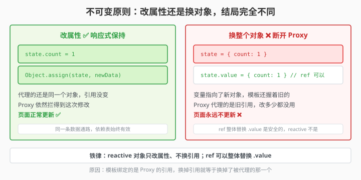

# 3.9 不可变原则：响应式的铁律

> 章节：第 3 章 响应式数据
> 课时：0.5 课时

---

## 🎯 学习目标

学完这节，你将能够：

- ✅ **理解**：什么是"不可变原则"以及它在 Vue 里为什么重要
- ✅ **区分**：整体替换 vs 修改属性——它们对响应式的不同影响
- ✅ **掌握**：`reactive` 对象整体替换的正确姿势
- ✅ **避坑**：解构、传参时响应式丢失的 3 个经典场景

---

## 🧠 思维导图

```text
3.9 不可变原则：响应式的铁律
├── 什么是不可变原则
│   ├── 不直接改原对象，而是创建新对象
│   ├── Vue 依赖引用变化来触发更新
│   └── 尤其是 shallowRef 和 computed
├── 整体替换 vs 字段修改
│   ├── reactive：整体替换会丢响应式（引用断了）
│   ├── ref：整体替换 .value 正常触发
│   └── 关键区别：Proxy 代理的是对象的引用
├── reactive 的"铁律"
│   ├── ❌ state = newObj（引用断了）
│   ├── ✅ Object.assign(state, newObj)
│   └── ✅ state.xxx = newVal（逐个字段改）
├── 响应式丢失三大陷阱
│   ├── 陷阱1：解构 reactive 对象
│   ├── 陷阱2：把响应式数据传给普通函数
│   └── 陷阱3：把它赋给普通变量
└── 正确姿势总结
    ├── reactive 对象 → 只改属性，不替换本身
    ├── ref → 整体替换 .value 完全 OK
    └── 函数返回 → 用 ref，不要 return reactive 的裸属性
```

学完 `ref`/`reactive`，很多人掉进同一个坑：明明改了数据，页面却"装死"。比如 `state.user = {...}` 重赋对象，或 `list.filter(...)` 换新数组——Vue 愣是不更新。原因不在 Vue 傻，而是你破坏了"不可变原则"：跟踪的是同一个引用，引用一换，旧链接就断了。本节讲清这条铁律和正确改法。

---

## 🤔 一、不可变原则是什么？

"不可变原则"听起来高大上，但说白了就是一句话：

> **创建新对象，而不是修改旧对象。**

在 Vue 中，这特别重要——因为 Vue 靠"引用的变化"来判断数据有没有变。你改了对象内部的一个字段，Vue 通过 Proxy 能感知；但你把整个变量指向一个新对象，Vue 要看情况才能感知。

更直白点：**Vue 是在对象上装了"监控"。你把整个对象换掉，监控就没了。**

> 🎯 **类比一下：Vue 的"门禁卡"只认卡号**
>
> `reactive` 对象就像一张**实名门禁卡**——闸机里登记的是**卡号**（对象的引用），不是你卡面上印的内容。你在卡面上改一个字段（`state.count = 1`），卡号没变，闸机照常放行；可你要是"换了一张新卡"（`state = {...}` 让变量指向新对象），闸机里登记的卡号就对不上了——从此数据怎么变，页面都不再开门。
>
> 一句话记住：**Vue 认卡号，不认卡面。**

---




## 💡 二、reactive 的铁律：不要整体替换

```js
import { reactive } from 'vue'

let state = reactive({ count: 0, name: 'vue' })

// ❌ 致命错误：把 state 指向一个新对象
state = reactive({ count: 1, name: 'react' })  
// 上面的 state 变量变了，但模板里引用的还是旧对象！
```

问题出在哪？`reactive()` 返回的是一个 **Proxy 代理对象**。模板里绑定的是**这个代理对象的引用**。你把 `state` 指向新代理，模板里还是老的——它们之间没有关系了。

### 正确姿势

**方案一：逐个字段改**

```js
state.count = 1
state.name = 'react'
// 或者
Object.assign(state, { count: 1, name: 'react' })
```

**方案二：用 ref 包整个对象**

```js
const state = ref({ count: 0, name: 'vue' })

// ✅ ref 整体替换 .value 完全 OK
state.value = { count: 1, name: 'react' }
```

为什么 `ref` 可以整体替换？因为模板绑的是 `ref` 本身（`RefImpl` 实例），`state.value` 换成一个新对象时，`ref` 的 setter 会触发 `trigger`——模板会更新。

> 💬 **老师备注**：区分"整体替换"和"修改属性"有个偷懒记法——**响应式只认"从内部动"，不认"从外面换"**。凡是 reactive 对象，优先 `state.xxx = ...`、`Object.assign`；非要换整个对象，就先想想能不能换成 `ref`。

**方案三：用 `Object.assign` 合并**

```js
const state = reactive({ count: 0, name: 'vue', age: 20 })

// 从服务器拿到新数据
const newData = { name: 'new name', age: 21 }

// ✅ 合并进去，保留没有变化的字段
Object.assign(state, newData)
```

"整体替换 vs 修改属性"是响应式最容易翻车的地方，把 `reactive` 和 `ref` 的行为放在一起看：

| 对比维度 | `reactive` 对象 | `ref` 对象 |
|---|---|---|
| 整体替换 | ❌ 引用断了，模板不更新 | ✅ `state.value = 新对象` 正常触发 |
| 修改属性 | ✅ `state.count = 1` 触发更新 | ✅ 同样触发 |
| 底层原因 | 模板绑的是 Proxy 代理引用，换引用就失效 | 模板绑的是 `RefImpl` 实例，`.value` setter 触发 |
| 批量更新 | 用 `Object.assign` 合并 | 直接替换 `.value` |
| 推荐姿势 | 只改属性，不替换本身 | 整体替换、属性修改都行 |

---

## 🛠 三、完整对比例子

```vue
<script setup>
import { reactive, ref } from 'vue'

// ---- reactive 版（容易翻车） ----
const rState = reactive({ count: 0 })

function badReplace() {
  // ❌ 这样做：页面不更新！
  // rState = reactive({ count: 999 })
  // （上面会报错，因为 const 不能重新赋值。但用 let 也一样不更新）
}

function goodReplace() {
  // ✅ 这样做：
  Object.assign(rState, { count: 999 })
}

// ---- ref 版（更灵活） ----
const fState = ref({ count: 0 })

function replaceRef() {
  // ✅ 直接替换，页面会更新
  fState.value = { count: 999 }
}
</script>

<template>
  <div>
    <p>reactive 版：{{ rState.count }}</p>
    <button @click="goodReplace">reactive 更新</button>

    <p>ref 版：{{ fState.count }}</p>
    <button @click="replaceRef">ref 更新</button>
  </div>
</template>
```

---

## ⚠️ 四、响应式丢失三大陷阱

> 🎬 **小剧场：响应式丢失三连败**
>
> **第 1 幕·解构**：小新 `const { count } = state`——"我把值请出来了！" Vue 摊手："你请出来的只是个快照，原件怎么改都跟它没关系了。"
> **第 2 幕·传参**：小新把 `state.price` 交给普通函数 `applyDiscount(price)`——"函数里能算就行！" Vue："你递过去的是数字，不是链接；`state.price` 后来变了，那位函数毫不知情。"
> **第 3 幕·换引用**：小新 `let { items } = state; items = [1, 2, 3, 4]`——"我换了一整个数组！" Vue："你换的是局部变量 `items` 的指向，`state.items` 还站在原地没动。"
> **收场白**：三幕病因相同——**你拿到的是值或影子，不是那条通往 Proxy 的线。**

### 陷阱 1：解构 reactive 对象

```js
const state = reactive({ count: 0, name: 'vue' })

const { count } = state    // ❌ count 只是 0，不是响应式
count++                     // 页面不变

// ✅ 解决方案：toRefs
const { count } = toRefs(state)  // count 现在是 Ref(0)
count.value++                      // 页面更新
```

### 陷阱 2：在 computed 外读取派生值

```js
const state = reactive({ price: 100 })

// ❌ 计算只发生这一次，把结果存进普通变量
let discountPrice = state.price * 0.8   // 80
state.price = 200
console.log(discountPrice)               // 还是 80，不是 160

// ✅ 派生值必须写成 computed，才能跟着变
const discountPrice = computed(() => state.price * 0.8)
```

**判断标准很简单**：只要一个值是"由别的数据算出来的"，它就该是 `computed`，而不是一个 `let`。

### 陷阱 3：整体替换，而不是修改

```js
const state = reactive({ items: [1, 2, 3] })

// ❌ 把 state 本身换掉：变量指向了新对象，Proxy 断了
state = { items: [4, 5, 6] }         // TypeError（const），或响应式断链

// ❌ 解构后整体替换：state.items 一动没动
let { items } = state
items = [1, 2, 3, 4]// view 不更新

// ✅ 改内容，不换引用
state.items.push(4)                  // ✅
state.items = [1, 2, 3, 4]           // ✅（改的是 state 的属性，不是 state 自己）
```

> 💬 **老师备注：陷阱 3 是本章的核心**
> 关键区别在于**你在给谁赋值**：
> - `state.items = [...]` → 改的是 `state` 的一个属性，Proxy 拦得到✅
> - `state = [...]` → 换的是 `state` 这个变量本身，Proxy 拦不到 ❌
> - `let { items } = state; items = [...]` → 同上，解构出来的那一刻就脱离了代理 ❌
>
> 一句话：**永远修改属性，不要替换对象本身。**

> 🧊 **冷知识：这条"铁律"不是 Vue 发明的**
>
> "返回新对象、别改旧的"来自函数式编程的 **Immutability** 传统，React 的 `setState`、Redux 的 reducer 都把它写成了硬规矩。原因很实际：判断"引用换没换"只需比一次指针，而判断"对象里哪个字段变了"得逐层深比较——前者几乎免费。Vue 靠 `Proxy` 走了另一条路，所以对 `reactive` 宽容得多；可一旦碰上 `shallowRef`、`computed`、`props`，你还是得乖乖回到这条铁律上来。

---

## 🧠 本节小结

- **铁律一句话**：不整体替换已被跟踪的响应式对象，只修改它内部的内容（或替换容器 `.value`）
- **reactive 对象**：只改属性 `state.user.name = '李四'`，别 `state.user = {...}` 整体重赋
- **ref 是例外**：`refObj.value = 新对象` 整体替换完全 OK，因为替换的是容器的 `.value`
- **数组同理**：用 `push/splice` 等方法改原数组，别 `list = newList` 换引用
- **函数返回**：返回 `ref` 而不是 return reactive 的裸属性，否则调用方拿到的值会失去响应式

---

## 📝 即时练习

**练习 1**：写一个 `reactive` 表单对象，模拟"从服务器拿到新数据后更新表单"——先用错误方式（`state = newData`），观察为什么不行；再用 `Object.assign` 修正。

**练习 2**：解构一个 `reactive` 用户对象（`name`、`email`），观察修改解构后的变量页面不更新的现象；用 `toRefs` 修正后对比。

**练习 3**：比较 `ref` 和 `reactive` 在"整体替换"场景下的行为差异，总结出一条选型规则。

---

## 📚 拓展阅读

- [Vue 3 官方文档 - 响应式基础 - reactive 的局限性](https://cn.vuejs.org/guide/essentials/reactivity-fundamentals.html#limitations-of-reactive)
- [Vue 3 官方文档 - toRefs](https://cn.vuejs.org/api/reactivity-utilities.html#torefs)

---

**（3.9 节结束，下一节 3.10 ref 的底层套路 →）**
