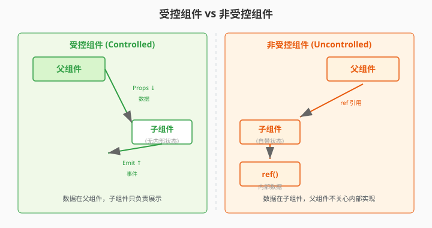

# 4.12 受控 vs 非受控

> 章节：第 4 章 组件化思想
> 课时：0.5 课时

---

## 🎯 学习目标

学完这节，你将能够：

- ✅ **理解**：受控组件和非受控组件的核心区别
- ✅ **掌握**：什么时候该用受控、什么时候该用非受控
- ✅ **应用**：用 v-model 实现受控组件
- ✅ **判断**：看到一个组件时能判断它是受控还是非受控

---

## 🧠 思维导图

```text
4.12 受控 vs 非受控
├── 什么是受控组件
│   ├── 数据由父组件 Props 传入
│   ├── 子组件不持有自己的状态
│   ├── 数据变化通过 emit 通知父组件
│   └── 类比：傀儡（线在父组件手里）
├── 什么是非受控组件
│   ├── 数据由子组件自己管理（ref/reactive）
│   ├── 父组件不关心内部状态
│   └── 类比：独立个体（自己管自己）
├── 受控 vs 非受控对比
│   ├── 受控：父组件掌控一切（单一数据源）
│   ├── 非受控：子组件自治（简单、省事）
│   └── 选择标准：数据是否需要被外部访问/控制
├── v-model：受控组件的标准模式
│   ├── 本质：Props + emit 的语法糖
│   ├── v-model="value" → :modelValue + @update:modelValue
│   └── 多个 v-model：v-model:title v-model:content
└── v-model 原理
    ├── 父组件：<Child v-model="data" />
    ├── 子组件接收：defineProps({ modelValue: ... })
    └── 子组件更新：emit('update:modelValue', newValue)
```

`v-model` 大家都会写，但一碰到自定义组件就开始玄学：为什么输入框内容变了，父组件的 `ref` 没跟着变？为什么有时改子组件内部状态，父组件数据也被带偏？背后是两种设计范式在打架——受控组件数据归父组件管，非受控组件数据在子组件内部自生自灭。搞不清边界，自定义表单组件就会写一个、崩一个。

> 🎯 **类比一下：受控 vs 非受控 ≈ 提线木偶 vs 自由演员**
> 受控组件像提线木偶——线（Props）在父组件手里，动一下都要父组件发指令（emit）；非受控组件像自由演员——剧本（数据）自己管，导演（父组件）只交代角色，不干涉表演。

> 🧑 **小白**：那我全用非受控不就行了？省得传参数。
> 🤖 **Vue 君**：搜索框可以，但表单输入框不行——提交时父组件要收集所有字段，数据在子组件手里就收不上来。
> 👨🏫 **老湿**：判断标准就一条：**这份数据需不需要被父组件访问/修改？** 需要就受控，不需要就非受控。

---

## 🤔 一、受控 vs 非受控：核心区别

### 一个故事讲清楚

想象你是班主任（父组件），你有两个学生干部：

- **小明（受控组件）**：事事听你指挥。你说"收作业"他才收，你说"发通知"他才发。他手里没有任何"自己的决定"。
- **小红（非受控组件）**：自己管理自己的事。她自己决定什么时候收作业、怎么收——你只需要告诉她"你是学习委员"就行了，不用管细节。

在 Vue 里：

- **受控组件**：数据由父组件通过 Props 传入。子组件自己不改数据，要改就 emit 通知父组件去改。**父组件是唯一的数据源**。
- **非受控组件**：数据在子组件内部自己管（用 `ref` / `reactive`），父组件不管也不关心。



### 代码对比

**受控组件**：

```vue
<!-- 子组件：MyInput.vue（受控） -->
<script setup>
defineProps({
  modelValue: String     // 值从父组件来
})
const emit = defineEmits(['update:modelValue'])
</script>

<template>
  <!-- 显示值用 Props，改值时 emit 通知父组件 -->
  <input
    :value="modelValue"
    @input="emit('update:modelValue', $event.target.value)"
  />
</template>
```


```vue
<!-- 父组件 -->
<script setup>
import { ref } from 'vue'
import MyInput from './MyInput.vue'
const name = ref('张三')    // 数据在父组件手里！
</script>

<template>
  <MyInput v-model="name" />
  <p>你输入的是：{{ name }}</p>
</template>
```

**非受控组件**：

```vue
<!-- 子组件：SearchBox.vue（非受控） -->
<script setup>
import { ref } from 'vue'
const keyword = ref('')        // 数据在子组件内部自己管

function search() {
  console.log('搜索：', keyword.value)
}
</script>

<template>
  <div>
    <input v-model="keyword" />
    <button @click="search">搜索</button>
  </div>
</template>
```

```vue
<!-- 父组件 -->
<template>
  <!-- 父组件不传值，完全不管内部状态 -->
  <SearchBox />
</template>
```

---

## 💡 二、v-model：受控组件的标准模式

受控组件有一个标准写法：**v-model**。它是 Vue 给"Props 传入 + emit 传出"这对组合起的语法糖——**受控模式的语法化表达**。

```vue
<!-- 一句话记住这个公式 -->
<MyInput v-model="name" />  ≡  :modelValue="name" + @update:modelValue="name = $event"
```

> 📌 **完整写法在第 5 章**：包括子组件怎么声明 `modelValue` / 怎么 `emit`、多个 `v-model` 的带参写法（`v-model:title`）、以及 Vue 3.4+ 新增的 `defineModel` 写法——**都在 05.7 讲**。
>
> 本节只关心"**什么时候该用受控**"这个判断问题，语法细节留到第 5 章。

---

## 💡 三、怎么选：受控还是非受控？

| 判断标准 | 受控 | 非受控 |
|---|---|---|
| 数据需要被父组件访问？ | ✅ 是 | ❌ 不需要 |
| 数据需要被外部修改？ | ✅ 是 | ❌ 不需要 |
| 需要数据校验？ | ✅ 父组件统一校验 | ❌ 子组件自己校验即可 |
| 组件可能被多个页面复用？ | ✅ 倾向于受控 | ⚠️ 也可以（看情况） |

### 典型场景

| 组件 | 推荐模式 | 原因 |
|---|---|---|
| 表单输入框 `<BaseInput>` | **受控** | 数据需要在父组件收集和提交 |
| 搜索框 `<SearchBox>` | 非受控 | 搜索词只在内部用，外面不关心 |
| 弹窗 `<Modal>` | **受控**（visible） | 父组件需要控制弹窗开关 |
| Tab 切换 `<Tabs>` | **受控**（active） | 父组件可能需要主动切 Tab |
| 轮播图 `<Carousel>` | 非受控 | 自己管理翻页状态 |
| 下拉选择 `<BaseSelect>` | **受控** | 选中的值需要在表单里收集 |
| 评论列表 `<CommentList>` | 非受控 | 列表数据自己拉，外面只看结果 |

> 💬 **老师备注**：**受控不意味着"复杂"，非受控不意味着"简单"**。受控让数据流更清晰、可追溯；非受控让组件更独立、少写代码。**关键看"这份数据要不要被外面管"**。

---

## ⚠️ 四、常见陷阱

### 陷阱 1：受控组件内部又用 ref 存了一份

```vue
<script setup>
import { ref, watch } from 'vue'
const props = defineProps({ modelValue: String })

// ❌ 别这么做！
const localValue = ref(props.modelValue)
watch(() => props.modelValue, (val) => { localValue.value = val })
</script>
```

这样就变成了"两个数据源"——`modelValue` 和 `localValue`，极易出现不同步的 bug。

### 陷阱 2：受控组件"看起来能改"，实际改不动

```vue
<!-- ❌ 直接 v-model 到 Props -->
<input v-model="modelValue" />
```

Props 是只读的，v-model 会尝试写——Vue 报警告。**正确的做法是 emit**。

### 陷阱 3：非受控组件忘了暴露关键方法

```vue
<script setup>
import { ref } from 'vue'
const keyword = ref('')
function search() { /* ... */ }
defineExpose({ search, keyword }) // ← 暴露给父组件
</script>
```

---

## 🧠 本节小结

- **核心区别只有一个**：值归谁管——受控组件值由父组件通过 Props 传入并监听事件更新；非受控组件值存在组件内部（如 `ref`）
- **v-model 是受控模式的标准糖**：`v-model` = `:modelValue` + `@update:modelValue`，本质是"父组件管值"
- **怎么选**：需要联动、校验、多组件共享一份数据 → 受控；只在本组件内部用、不想层层传事件 → 非受控
- **三个坑**：受控组件内部别再 `ref` 存一份（双份状态打架）；只改内部不改父组件 = "看起来能改实际改不动"；非受控组件要暴露 reset/clear 等关键方法
- **判断口诀**：想确认是哪种？看这个组件删掉 Props 后还能不能自洽运行

> 🧊 **冷知识**："受控/非受控"这组词最早来自 React 表单体系（controlled / uncontrolled inputs），Vue 社区沿用同一套术语。面试时能说出"v-model 本质是受控模式在 Vue 里的语法糖"，比只会抄代码强得多。

<details><summary>🔍 想深究再看：Vue 3 的多个 v-model 怎么写？</summary>

Vue 3 支持 `v-model:title="t"`、`v-model:content="c"` 这种带参数写法，子组件分别接收 `title` / `content` 两个 Props，并 emit `update:title` / `update:content`。本质上就是多组受控通道——每组都遵守"Props 进、emit 出"的规矩。第 5 章会展开，现在先记住"每个 v-model 都是一条受控链路"。

</details>

---

## 📝 即时练习

**练习 1（判断）**：以下场景分别适合受控还是非受控？为什么？
- 一个全局的"主题切换"开关
- 一个评论区输入框（需要在提交前做内容校验）
- 一个音乐播放器组件

**练习 2（动手）**：把 4.6 节的 AppModal 改成受控模式（`visible` 通过 v-model 控制），确保父组件可以控制弹窗打开/关闭。

**练习 3（进阶）**：实现一个 `<BaseInput>` 组件，支持 v-model 绑定值、Props：placeholder / type / disabled。

---

## 📚 拓展阅读

- [Vue 3 官方文档 - 组件 v-model](https://cn.vuejs.org/guide/components/v-model.html)
- [Vue 3 官方文档 - defineExpose](https://cn.vuejs.org/api/sfc-script-setup.html#defineexpose)

---

**（4.12 节结束，下一节 4.13 是本章小测 →）**
