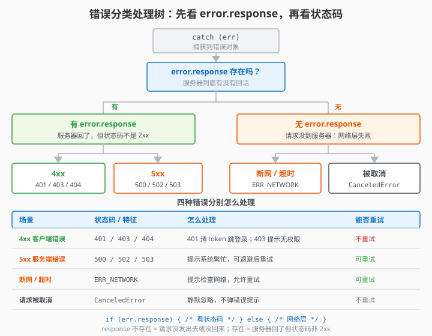
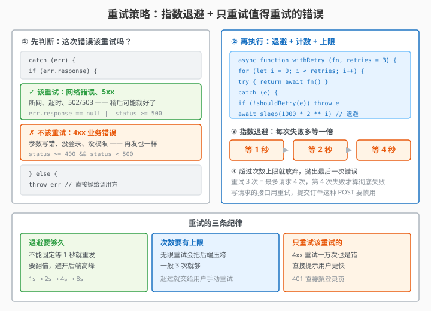

# 9.6 错误处理与重试

> 章节：第 9 章 服务端通信
> 课时：0.5 课时

---

## 🎯 学习目标

学完这节，你将能够：

- ✅ **掌握**：HTTP 状态码的分类（2xx / 4xx / 5xx）及对应处理策略
- ✅ **掌握**：区分网络错误、超时错误、业务错误三种错误类型
- ✅ **掌握**：手写一个请求重试逻辑（失败后自动重试 N 次）
- ✅ **理解**：什么错误该重试、什么错误不该重试

---

## 🧠 思维导图

```text
9.6 错误处理与重试
├── 错误的三层分类
│   ├── 网络层：网络断了、DNS 解析失败 → 完全没有 response
│   ├── HTTP 层：4xx（前端的问题）、5xx（后端的问题）
│   └── 业务层：HTTP 200 但 code !== 0（比如余额不足）
├── HTTP 状态码速查
│   ├── 2xx：成功（200 OK、201 Created）
│   ├── 3xx：重定向（301、302）
│   ├── 4xx：客户端错误（400 参数错、401 未登录、403 无权限、404 不存在）
│   └── 5xx：服务器错误（500 内部错误、502 网关错误、503 服务不可用）
├── 错误处理策略
│   ├── 4xx：提示用户纠正（比如"标题不能为空"）
│   ├── 401：清除 token → 跳转登录页
│   ├── 5xx：提示"服务器繁忙" + 可选重试
│   └── 网络错误：提示"网络异常" + 可选重试
├── 手写重试逻辑
│   ├── 重试次数上限（比如最多 3 次）
│   ├── 重试间隔（指数退避：1 秒 → 2 秒 → 4 秒）
│   ├── 什么该重试：5xx、网络超时
│   └── 什么不该重试：4xx（重试也没用）
└── 一句话总结
    └── 不同错误不同处理，5xx 和网络错误可以重试，4xx 不行
```

上一节把错误统一丢给拦截器弹 alert，可你慢慢会发现：同样是失败，有的是前端参数错、有的是后端崩了、有的是网断了，处理方式天差地别——4xx 重试一万次也没用，5xx 等一会儿可能就好，POST 乱重试还会造出重复订单。这节先把「锅」分清楚，再手写一个带指数退避的重试函数，最后聊两句生产级的重试策略。

> 🎯 **类比一下：错误处理 ≈ 医院分诊台**
> 病人（请求失败）来了，护士（错误分类）先问一句"哪不舒服"：**挂错号**（4xx）——重新挂号就行，多排几次队（重试）也没用；**医生设备坏了**（5xx）——等一会儿医生修好（稍后重试）就好；**救护车堵路上**（网络错误）——只能等路通（检查网络再试）。分诊台知道什么病该等、什么病该转科，比病人自己瞎折腾高效得多。

> 🧑 **小白**：请求失败就 alert 一句"出错了"，不行吗？
> 🤖 **Vue 君**：能跑，但用户被一句"出错了"搞懵：是我的网络？是服务器崩了？还是我没权限？分类提示"网络异常""服务器繁忙""登录已过期"，用户才知道下一步该干嘛。
> 👨🏫 **老湿**：**4xx 别重试（参数错了重试一万遍也没用）；5xx 和网络错误才值得重试；POST 类请求重试前必须想清楚会不会造成重复下单**。

---

## 🤔 一、请求失败了，到底是谁的问题？

后端返回的错误码，你得先判断"是谁的锅"：

```text
4xx（Client Error）
    → 前端的问题：参数错了、没登录、URL 写错了
    → 重试没用！修好前端代码再发

5xx（Server Error）
    → 后端的问题：代码崩了、数据库挂了
    → 前端能做的：提示用户 + 等一会重试

网络错误（无 response）
    → 网络断了、DNS 失败、超时
    → 前端能做的：提示用户 + 等一会重试
```

> 💬 **老师备注**：搞清楚"谁的问题"是第一步。很多初学者看到 400 就一直重试——参数都错了重试一万遍也没用。

---




## 💡 二、实战：分类处理错误

### 2.1 在拦截器里分类

上一节我们在响应拦截器里写了 switch-case。这节把它写得更清晰：

```js
// src/utils/request.js — 响应拦截器（错误处理版）
request.interceptors.response.use(
  (response) => response.data,
  (error) => {
    if (error.response) {
      // 后端返回了响应（有 status code）
      const { status, data } = error.response

      if (status >= 500) {
        // 5xx：后端崩了
        alert('服务器繁忙，请稍后重试')
      } else if (status === 401) {
        // 401：token 过期
        localStorage.removeItem('token')
        window.location.href = '/login'
      } else if (status === 403) {
        alert('您没有权限执行此操作')
      } else if (status === 404) {
        alert('请求的资源不存在')
      } else if (status === 400) {
        // 400：参数错误——把后端的错误信息展示出来
        alert(data?.message || '请求参数有误')
      } else {
        alert(`请求失败（状态码：${status}）`)
      }
    } else if (error.code === 'ECONNABORTED') {
      // 超时
      alert('请求超时，请检查网络后重试')
    } else {
      // 网络断了，或根本没有响应
      alert('网络异常，请检查网络连接')
    }

    return Promise.reject(error)
  }
)
```

### 2.2 error 对象的内部结构

`catch` 拿到的 `error` 对象，有几个关键属性：

```js
try {
  await request.get('/api/data')
} catch (error) {
  console.log(error.response)   // 后端的响应（有 status、data、headers）
  console.log(error.code)       // 错误代码：'ECONNABORTED'（超时）、'ERR_NETWORK'（网络错误）
  console.log(error.message)    // 人类可读的错误描述
}
```

| 属性 | 什么时候有 | 什么时候没有 |
|---|---|---|
| `error.response` | 后端返回了响应（包括 4xx、5xx） | 网络断了、超时 |
| `error.code` | 都有 | — |
| `error.message` | 都有 | — |

---




## 🔑 三、手写重试逻辑

### 3.1 核心思路

重试就是：请求失败了 → 等一会 → 再发一次 → 还是失败 → 再等 → 再发 → 超过最大次数就放弃。

```text
第 1 次发请求 → 失败（500）
  ↓ 等 1 秒
第 2 次发请求 → 失败（500）
  ↓ 等 2 秒
第 3 次发请求 → 成功（200）✅
```

### 3.2 手写 `retryRequest` 函数

```js
// src/utils/retry.js

/**
 * 带重试的请求
 * @param {Function} requestFn - 发请求的函数（返回 Promise）
 * @param {Object} options
 * @param {number} options.maxRetries - 最大重试次数，默认 3
 * @param {number} options.baseDelay - 基础等待时间（毫秒），默认 1000
 * @returns {Promise}
 */
export async function retryRequest(requestFn, options = {}) {
  const { maxRetries = 3, baseDelay = 1000 } = options

  for (let attempt = 0; attempt <= maxRetries; attempt++) {
    try {
      // 尝试发请求
      const result = await requestFn()
      return result   // 成功就直接返回
    } catch (error) {
      // 判断这个错误该不该重试

      // 4xx 不重试——重试也没用
      if (error.response && error.response.status >= 400 && error.response.status < 500) {
        throw error   // 直接抛出，不重试
      }

      // 已经是最后一次尝试了，放弃
      if (attempt === maxRetries) {
        throw error
      }

      // 计算等待时间：指数退避（1s → 2s → 4s）
      const delay = baseDelay * Math.pow(2, attempt)
      console.log(`第 ${attempt + 1} 次重试，等待 ${delay}ms...`)

      // 等待
      await new Promise((resolve) => setTimeout(resolve, delay))
    }
  }
}
```

### 3.3 在组件里用

```vue
<script setup>
import request from '@/utils/request'
import { retryRequest } from '@/utils/retry'
import { ref } from 'vue'

const data = ref(null)

const fetchData = async () => {
  try {
    data.value = await retryRequest(
      () => request.get('/api/data'),
      { maxRetries: 3, baseDelay: 1000 }
    )
  } catch (err) {
    alert('加载失败，已重试 3 次仍无法获取数据')
  }
}
</script>
```

### 3.4 集成到响应拦截器（更高阶，⚠️ 生产环境别这么写）

把重试写进响应拦截器，组件就不用关心重试了。但**这个写法有两个真实问题**：

```js
// ⚠️ 手写版（仅教学用）——生产项目请改用 axios-retry
request.interceptors.response.use(
  (response) => response.data,
  async (error) => {
    const { config } = error

    // 已经重试过，或 4xx（客户端错误，重试也没用）→ 不重试
    if (!config || config._retryCount >= 2 || (error.response && error.response.status < 500)) {
      return Promise.reject(error)
    }

    config._retryCount = (config._retryCount || 0) + 1

    // 指数退避：1s → 2s → 4s
    const delay = 1000 * Math.pow(2, config._retryCount - 1)
    await new Promise((resolve) => setTimeout(resolve, delay))

    return request(config)   // 重新发请求
  }
)
```

**两个问题**：

1. **退避等待会阻塞整条拦截器链**。上面那个 `await setTimeout` 期间，这个 Axios 实例的**其他请求**的状态判断也全部停滞。如果某个请求要等 4 秒才放弃，整个应用的错误处理都会跟着卡住。
2. **无法区分哪些请求该重试**。POST（下单、支付）重试可能造成重复订单，而拦截器是"一刀切"的。

> 💬 **老师备注：生产环境的正确做法是用库**
> ```js
> import axiosRetry from 'axios-retry'
>
> axiosRetry(request, {
>   retries: 2,
>   retryDelay: (retryCount) => axiosRetry.exponentialDelay(retryCount),
>   retryCondition: (error) => axiosRetry.isNetworkOrIdempotentRequestError(error)
> })
> ```
> `axios-retry` 已经处理好了上面两个问题（用 `setTimeout` 不阻塞主链、按方法和错误类型判断该不该重试）。**手写一遍是为了让你看懂原理，实际项目直接装库。**
>
> 另外，**第 9.7 节的 `useRequest` 也管重试**——那是"单个请求视角"的封装（可取消、可重置状态），拦截器是"全局视角"。**不要两层都开**，否则会重试两次。选一层：全局自动重试用 `axios-retry`，局部精细控制用 `useRequest`。

---

## 🛠 四、重试策略的生产级考虑

手写的重试逻辑能跑通，但实际项目里还有更多细节：

| 考虑点 | 说明 |
|---|---|
| **指数退避** | 不是固定间隔重试，而是越来越久（1s → 2s → 4s），给后端恢复时间 |
| **随机抖动** | 延迟加上一个随机数（如 ±200ms），避免大量客户端同时重试造成"惊群效应" |
| **幂等性** | POST 请求重试可能创建重复数据！只有 GET / PUT / DELETE（幂等操作）才适合重试 |
| **重试上限** | 总重试次数不要太夸张，最多 3-5 次 |

```js
// 带随机抖动的指数退避
const delay = baseDelay * Math.pow(2, attempt) + Math.random() * 500
// 1 秒 + 随机 0~500ms → 2 秒 + 随机 → 4 秒 + 随机
```

---

## ⚠️ 五、常见陷阱

### 陷阱 1：所有请求都重试，包括 POST

```js
// ❌ 危险：POST 重试可能创建两条订单
await retryRequest(() => request.post('/api/orders', orderData))
```

**解决办法**：重试函数里判断请求方法，POST 不重试；或者在调用时传 `maxRetries: 0`。

### 陷阱 2：把 4xx 也重试

```js
// ❌ 无意义：400 Bad Request 重试 100 次也过不去
await retryRequest(() => request.post('/api/users', { name: '' }))
```

4xx 是"你的请求有问题"，修好再发，不要重试。

### 陷阱 3：网络断了，一直弹 alert

如果拦截器里对所有错误都弹 `alert`，网络一断用户可能被弹窗轰炸。建议错误提示用 toast（比如 Element Plus 的 `ElMessage`），不要用 `alert`。

### 陷阱 4：忘记区分 `error.response` 有还是没有

```js
// ❌ 直接读 error.response.status，网络错误时 error.response 是 undefined
const status = error.response.status   // Cannot read properties of undefined

// ✅ 先判断
if (error.response) {
  // 有响应时再用 status
}
```

---

## 🧠 本节小结

- **错误三层分类**：网络错误（断网/超时，无 `response`）、HTTP 错误（4xx 前端问题 / 5xx 后端问题）、业务错误（HTTP 200 但 `code !== 0`）
- **error 对象关键属性**：`error.response` 仅在收到响应时有（含 `status`）；`error.code` 区分超时 `ECONNABORTED` 与网络错误 `ERR_NETWORK`
- **什么该重试**：5xx、网络错误值得重试；4xx 重试没用（修代码）；POST 不重试（不幂等，会造重复数据）
- **retryRequest 套路**：`attempt <= maxRetries` 循环 + 4xx 提前 `throw` + 指数退避 `delay = baseDelay * 2^attempt`
- **生产级细节**：加随机抖动防惊群、重试上限 3-5 次、用 `config._noRetry` 排除特定请求、错误提示用 toast 别用 `alert`

> 🧊 **冷知识**：指数退避为什么要"加随机抖动"？想象 1000 个用户同时遇到 503，如果都按"1s → 2s → 4s"同步重试，第 1 秒、第 3 秒、第 7 秒会形成三次"重试洪峰"——服务器刚缓过来又被 1000 个请求打趴。加抖动（`delay + Math.random() * 300`）让每个人的重试时间错开，像"错峰下班"一样分散压力。这就是生产级重试和玩具重试的差别。

<details><summary>🔍 想深究再看：为什么 POST 不重试？"幂等"到底是什么意思？</summary>

"幂等（Idempotent）"指**同一个操作执行 1 次和执行 N 次，结果一样**。GET 读数据、DELETE 删同一条数据都是幂等的：重发一次无害。POST 是"创建"——每次执行都**新增一条记录**：请求超时后重试，服务器可能已经创建成功，再发一次就造出两条一模一样的订单/帖子。所以规范是：**POST 不自动重试**，需要"创建类重试安全"得先给请求带幂等键（Idempotency Key），后端拿同一个键去重。下单、支付这类接口，重试策略必须格外谨慎，这就是"重试要分场景"的深层原因。

</details>

---

## 📝 即时练习

**练习 1**：把 9.5 节写的 `request.js` 升级，在响应拦截器里加上完整的错误分类处理（参考本节 2.1 的代码）。

**练习 2**：实现 `retryRequest` 函数，让它只重试 GET 请求和 5xx 错误，最多重试 3 次。

**练习 3**：故意把一个 GET 请求的 URL 写错（触发 404），验证重试逻辑有没有正确跳过（4xx 不重试）。再把 URL 改成 `https://httpstat.us/500`（一个专门返回 500 的测试接口），验证重试有没有生效。

---

## 📚 拓展阅读

- [MDN - HTTP 状态码](https://developer.mozilla.org/zh-CN/docs/Web/HTTP/Status)
- [axios-retry 库](https://github.com/softonic/axios-retry)（成熟的 Axios 重试插件）
- [指数退避算法](https://en.wikipedia.org/wiki/Exponential_backoff)

---

**（9.6 节结束，下一节 9.7 讲请求状态管理 →）**
