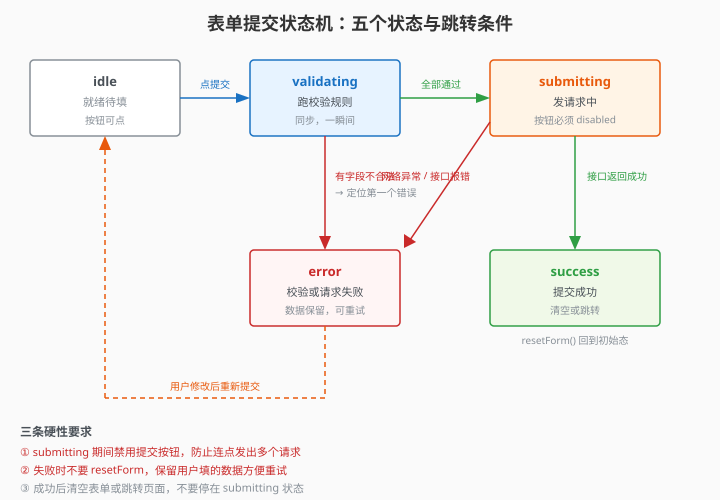

# 10.6 表单提交与重置

> 章节：第 10 章 表单处理与验证
> 课时：0.5 课时

---

## 🎯 学习目标

学完这节，你将能够：

- ✅ **掌握**：VeeValidate 的 `handleSubmit` 完整用法
- ✅ **掌握**：表单重置（`resetForm`）及其参数配置
- ✅ **理解**：提交状态管理（loading、success、error）
- ✅ **掌握**：提交前确认（"确定要提交吗？"）
- ✅ **掌握**：防止重复提交的实现方式

---

## 🧠 思维导图

```text
10.6 表单提交与重置
├── 提交
│   ├── handleSubmit(callback)：验证通过才调用 callback
│   ├── handleSubmit 的 invalidSubmit 钩子（验证未通过时的回调）
│   └── submitForm()：直接提交（跳过前端验证）
├── 提交状态管理
│   ├── loading / success / error 三个状态
│   ├── 防止重复提交（按钮 disabled + loading 文字）
│   └── 提交后跳转或弹窗提示
├── 重置
│   ├── resetForm()：恢复到初始值
│   ├── resetForm({ values: { ... } })：重置到指定值
│   └── resetField('fieldName')：重置单个字段
└── 确认弹窗
    └── 提交前用 confirm() 或自定义 dialog 二次确认
```

10.5 把验证规则玩明白了，可真正的提交流程还藏着一堆坑：验证通过只是第一步——用户连点 5 下注册按钮会不会发 5 个请求？接口返回 `{ code: 1 }` 算成功吗？提交失败把表单清空了用户想重试怎么办？这节把 submit 之后的完整生命周期补齐：防重复提交、loading / success / error 三态、`resetForm` 的四种用法、提交前二次确认。

> 🎯 **类比一下：表单提交流程 ≈ 餐厅下单**
> 验证通过只是"菜点好了"，后面还有一整套：**防重复提交**＝服务生不会因为客人连喊 5 声"下单"就录 5 单；**loading 三态**＝"厨房制作中/已上桌/厨房打回重做"；**二次确认**＝"您确认点这份 188 的套餐吗？"；**提交失败保留数据**＝菜做不了，单子留着客人改。一个健壮的提交，就是把这 5 步都走通，而不只是"点按钮发请求"。

> 🧑 **小白**：验证都通过了，提交不就是 `fetch` 一下吗？
> 🤖 **Vue 君**：`fetch` 只是第 1 步。后面还有：防重复（`submitting` 禁用按钮）、三态（loading/success/error）、失败保留数据（方便重试）、成功清空/跳转。漏掉任何一环，真实项目都会出事故。
> 👨🏫 **老湿**：**高频面试题"如何防止重复提交"**——`submitting` ref + `:disabled` + 提交完再恢复，是标准答案。而"失败后 `resetForm` 清空表单"是典型反例：用户想重试，数据没了。

---




## 🤔 一、提交不只是"发请求"

很多同学以为表单提交就是把数据发到后端，实际上一个健壮的提交流程包括：

1. **前端验证**：所有字段格式是否正确
2. **二次确认**：用户是否确定提交
3. **提交中状态**：按钮禁用 + loading 提示
4. **成功处理**：弹窗提示 + 清空表单或跳转
5. **失败处理**：显示后端返回的错误信息
6. **防重复**：提交中不允许再次点击

VeeValidate 帮我们解决了第 1 步，后面的 5 步需要在 `handleSubmit` 的回调里自己实现。

---

## 💡 二、handleSubmit 进阶用法

### 2.1 基本回调

```js
const { handleSubmit } = useForm({
  validationSchema: { ... }
})

// 只有验证通过才会执行这个回调
const onSubmit = handleSubmit(async (values) => {
  console.log('表单数据：', values)
  await fetch('/api/register', {
    method: 'POST',
    body: JSON.stringify(values)
  })
})
```

### 2.2 获取"验证未通过"的通知

有时候你想在验证失败时做一些事情（比如滚动到第一个错误字段）：

```js
const onSubmit = handleSubmit(
  // 第一个参数：验证通过的回调
  async (values) => {
    await submitToServer(values)
  },
  // 第二个参数：验证未通过的回调
  ({ errors }) => {
    console.log('验证未通过：', errors)
    // 滚动到第一个错误字段
    const firstError = document.querySelector('.error')
    firstError?.scrollIntoView({ behavior: 'smooth' })
  }
)
```

---

## 🛠 三、完整提交示例（含状态管理）

```vue
<script setup>
import { useForm } from 'vee-validate'
import { defineRule } from 'vee-validate'
import * as rules from '@vee-validate/rules'
import { ref } from 'vue'

defineRule('required', rules.required)
defineRule('email', rules.email)
defineRule('min', rules.min)
defineRule('confirmed', rules.confirmed)

const { handleSubmit, resetForm, errors } = useForm({
  validationSchema: {
    username: 'required|min:3',
    email: 'required|email',
    password: 'required|min:6',
    confirmPassword: 'required|confirmed:@password'
  }
})

// 状态管理
const submitting = ref(false)   // 提交中
const submitSuccess = ref(false) // 提交成功

const onSubmit = handleSubmit(async (values) => {
  // 防止重复
  if (submitting.value) return

  submitting.value = true
  submitSuccess.value = false

  try {
    // 模拟接口请求
    await new Promise(resolve => setTimeout(resolve, 1500))
    // const res = await fetch('/api/register', { ... })

    submitSuccess.value = true
    resetForm()  // 成功后清空表单

    // 3 秒后隐藏成功提示
    setTimeout(() => {
      submitSuccess.value = false
    }, 3000)
  } catch (err) {
    alert('提交失败：' + err.message)
  } finally {
    submitting.value = false
  }
})

// 二次确认
function confirmSubmit() {
  return window.confirm('确定要提交注册信息吗？')
}

// 带确认的提交
const onSubmitWithConfirm = handleSubmit(async (values) => {
  if (!confirmSubmit()) return  // 用户点了取消
  await onSubmit(values)
})
</script>

<template>
  <form @submit="onSubmit" class="form">
    <!-- 字段略，同前 -->

    <!-- 成功提示 -->
    <div v-if="submitSuccess" class="success">
      ✅ 注册成功！即将跳转...
    </div>

    <button type="submit" :disabled="submitting">
      {{ submitting ? '提交中...' : '注册' }}
    </button>
  </form>
</template>

<style scoped>
/* 略 */
.success {
  color: #27ae60;
  padding: 12px;
  background: #eafaf1;
  border-radius: 6px;
  margin-bottom: 12px;
}
button:disabled {
  opacity: 0.6;
  cursor: not-allowed;
}
</style>
```

---

## 💡 四、表单重置

### 4.1 基本重置

```js
// 恢复到表单的初始值
resetForm()
```

"初始值"是什么？是指 `useForm` 创建时各字段的值。如果创建时所有字段都是空的，`resetForm()` 后就全空了。

### 4.2 重置到指定值

```js
resetForm({
  values: {
    username: '',
    email: '',
    password: '',
    confirmPassword: ''
  }
})
```

这在编辑表单中特别有用——编辑模式下重置到原始数据，而不是空值。

### 4.3 重置单个字段

```js
// useField 返回的 resetField
const { value, errorMessage, resetField } = useField('email', 'required|email')

// 只重置 email 字段（值和错误都清）
resetField()
```

### 4.4 resetForm 的完整参数

```js
resetForm({
  values: { username: '' },          // 重置到指定值
  touched: false,                     // 清除"是否触碰过"的状态
  errors: false                       // 是否保留错误信息
})
```

> 💬 **老师备注**：很多同学在提交失败后希望保留用户已填的数据和错误高亮，这时用 `resetForm({ errors: true })` 只清状态不清数据。当然，更常见的做法是失败后不重置、成功后清空。

---

## ⚠️ 五、常见陷阱

### 陷阱 1：重复提交

```js
// ❌ 没有防重复，用户连点 5 下就发 5 个请求
const onSubmit = handleSubmit(async (values) => {
  await fetch('/api/register', { ... })
})
```

解决方案：`submitting` ref + 按钮 `:disabled`，或者用防抖。

### 陷阱 2：成功和失败都 resetForm

```js
// ❌ 提交失败也清空了表单，用户填的数据白费了
try {
  await fetch('/api/register', { ... })
  resetForm()
} catch {
  resetForm()  // 用户想重试，但数据没了
}
```

失败时应该保留数据让用户修改后重试，只在成功时清空。

### 陷阱 3：忘记处理接口返回的业务错误

```js
// ❌ 接口返回 { code: 1, message: '用户名已存在' } 但代码里当成功处理
const res = await fetch('/api/register', { ... })
resetForm()  // 直接清空
```

接口返回的状态码可能是 200，但业务上失败了。需要检查业务状态码：

```js
const data = await res.json()
if (data.code === 0) {
  resetForm()
} else {
  alert(data.message)  // 保留表单数据，让用户修改
}
```

### 陷阱 4：表单提交后页面刷新

```vue
<!-- ❌ 原生 form 提交会导致页面刷新 -->
<form @submit="onSubmit">

<!-- ✅ 加 .prevent 阻止默认行为 -->
<form @submit.prevent="onSubmit">
```

不过 VeeValidate 的 `handleSubmit` 返回值内部已经调了 `preventDefault`，直接用 `@submit="onSubmit"` 也可以（`onSubmit` 是 `handleSubmit` 的返回值）。

---

## 🧠 本节小结

- **健壮提交 = 6 步**：前端验证 → 二次确认 → 提交中 loading → 成功处理 → 失败处理 → 防重复点击，VeeValidate 只包办了第 1 步
- **handleSubmit 双回调**：第一个参数验证通过执行；第二个参数 `({ errors })` 在验证未通过时执行（滚动到第一个错误字段）
- **防重复提交**：`submitting` ref + 按钮 `:disabled` + 回调开头 `if (submitting.value) return`；避免连点发出多个请求
- **resetForm 用法**：无参恢复到初始值；`{ values: {...} }` 重置到指定值（编辑表单用）；`useField` 的 `resetField()` 重置单字段
- **失败不清空**：只在成功后 `resetForm()`；失败保留用户数据便于修改重试
- **业务错误别当成功**：HTTP 200 ≠ 成功，检查 `data.code === 0` 之类的业务状态码；二次确认用 `confirm()` 包一层

> 🧊 **冷知识**：HTTP 200 只代表"请求送达、服务器没崩"，不代表"业务成功"。很多后端约定 `{ code: 0, msg: 'ok' }` 才是成功，`code: 1` 可能是"手机号已注册"这类业务失败。所以提交回调里**先看 `data.code` 再看 HTTP 状态**，`res.ok` 为 true 就当作成功是生产事故的头号来源。

<details><summary>🔍 想深究再看：`resetForm({ values: {...} })` 与无参 `resetForm()` 的区别？</summary>

无参 `resetForm()` 把表单恢复到**初始值**（`useForm({ initialValues })` 里声明的初值），适合"新表单/提交成功后清空"。带参 `resetForm({ values: { username: 'admin' } })` 是**重置到指定值**，适合"编辑表单"场景：打开页面时把后端拉回来的数据填进去。另外注意 `useField` 的 `resetField()` 只重置单个字段。选错 API 的典型症状：编辑页一 `resetForm()` 把用户刚填的草稿全清了——因为它恢复到的是"初始值"，不是"当前值"。

</details>

---

## 📝 即时练习

**练习 1**：在提交回调中实现"提交失败后滚动到第一个错误字段"的功能，用 `document.querySelector` 和 `scrollIntoView`。

**练习 2**：实现一个"自动保存草稿"的功能——用户每次修改表单，3 秒后自动将数据存入 `localStorage`，下次打开页面时自动回填。

**练习 3**：给表单加一个"提交前预览"弹窗——点击提交后不直接发请求，而是弹出一个模态框展示用户填写的所有信息，用户再次点击"确认"才真正提交。

---

## 📚 拓展阅读

- [VeeValidate 4 - useForm API（handleSubmit / resetForm）](https://vee-validate.logaretm.com/v4/api/use-form)
- [MDN - Fetch API](https://developer.mozilla.org/zh-CN/docs/Web/API/Fetch_API)
- [MDN - Window.confirm](https://developer.mozilla.org/zh-CN/docs/Web/API/Window/confirm)

---

**（10.6 节结束，下一节 10.7 综合实战：注册表单 →）**
