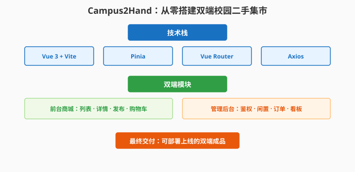

# 12.1 项目概览与需求分析

> 章节：第 12 章 综合项目：「Campus2Hand」校园二手集市
> 课时：0.5 课时

---

## 🎯 学习目标

学完这节，你将能够：

- ✅ **理解**：Campus2Hand 校园二手集市的**双端架构**（前台商城 + 管理后台）与核心功能模块
- ✅ **掌握**：如何从需求分析出发，拆解双端功能点
- ✅ **了解**：技术选型背后的理由（Vue 3 + Vite + Pinia + Vue Router + Axios + Element Plus）
- ✅ **明确**：本课程设计项目的验收标准

---

## 🧠 思维导图

```text
12.1 项目概览与需求分析
├── 项目定位
│   ├── Campus2Hand 校园二手集市（前台商城 + 管理后台）
│   ├── 同一工程双端路由（前台 /home 公开，后台 /dashboard 鉴权）
│   └── 课设级别（非生产级）
├── 前台商城模块（公开访问）
│   ├── 首页：闲置列表与搜索筛选
│   ├── 闲置物品详情与留言
│   ├── 发布闲置（表单 + 图片预览）
│   ├── 购物车与模拟下单
│   └── 登录注册（JWT + Pinia）
├── 管理后台模块（需登录鉴权）
│   ├── 数据看板（Dashboard）
│   ├── 闲置物品管理（CRUD + 图片上传）
│   ├── 交易订单管理（列表 + 状态流转 + 详情）
│   └── 用户管理（可选扩展）
├── 技术选型
│   ├── Vue 3（组合式 API + script setup）
│   ├── Vite（构建工具）
│   ├── Pinia（状态管理）
│   ├── Vue Router 5（路由，双端分层）
│   ├── Axios（HTTP 请求）
│   └── Element Plus（UI 组件库）
└── 验收标准
    ├── 双端功能完整（前台可逛/可发/可下单，管理后台可管/可看）
    ├── 代码规范（ESLint + 目录规范）
    └── 可运行部署（Vite build 成功）
```



从第 1 章的"Vue 是个啥玩意儿"一路走到 11.7，你已经集齐了组件、响应式、路由、Pinia、Axios 甚至测试与错误处理——是时候打一场"总决战"了。这一章用 2 周课设体量的 **Campus2Hand 校园二手集市（前台商城 + 管理后台）**，把前 12 章的知识点串成一条真实开发流水线，也用它和前面 11 个章末实战小项目（P1~P11）合拢成完整的项目体系。本节先不开代码编辑器，而是把需求和蓝图画清楚：系统做给谁、双端各有哪些模块、为什么偏偏选这六个技术、验收标准是什么——想清楚这些，后面 18 节才不会写着写着返工。

> 🎯 **类比一下：综合项目 ≈ 给新房子画"施工图"**
> 直接开工装修，你大概率会在装到一半时发现：插座位置不对、卧室没留衣柜位、阳台怎么封都别扭——返工成本比设计成本高得多。需求分析就是"先画施工图"：房子给谁住（用户）、几室几厅（模块）、用什么建材（技术选型）、验收标准是什么（怎么算合格）。**先想清楚再动手，18 节才不会写着写着返工**——这正是本节的价值。

> 🧑 **小白**：前面 P1~P11 也是项目，为什么第 12 章非要再来一个？
> 🤖 **Vue 君**：P1~P11 是"单点小练习"：一个组件、一个路由、一个表单，每课只练一种招式；Campus2Hand 是把所有招式**连成一整套动作**——双端、鉴权、CRUD、看板、部署，缺一环就站不起来。
> 👨🏫 **老湿**：**"知识点 ≠ 能力"是本节的中心句**。面试官问"你用 Vue 做过什么"，要的不是你背出 reactive 和 ref 的区别，而是你**完整走通过一条开发链路**。这个双端集市就是你的"作品集"。

---

## 🤔 一、为什么需要做一个综合项目？

前 12 章你学了大量知识点：组件、Props、事件、响应式、组合式 API、路由、状态管理、Axios……

但**知识点 ≠ 能力**。

就像你背了所有菜谱，不代表你能做一桌宴席。综合项目就是那桌宴席——把你学过的所有知识**串起来**，在一个真实场景里用一遍。

> 💬 **老师备注**：很多企业面试官不会问你"Vue 3 的 reactive 和 ref 有什么区别"，而是直接让你"用 Vue 3 做一个完整项目"。这一章的双端校园集市，就是帮你准备好这个答案。

---

## 💡 二、项目定位：Campus2Hand 校园二手集市（前台 + 管理后台双端）

**Campus2Hand** 是一个面向校园的**二手闲置交易平台**。它不是单页面的小玩具，而是同一 Vue 工程内的**双端应用**——共用 API 层、Pinia store 与组件库，但路由分区、访问权限、页面目标完全不同：

- **前台商城（买家/卖家视角，公开访问）**：逛闲置、看详情、留言砍价、发布闲置、加购下单——面向全校同学
- **管理后台（运营/管理员视角，需登录鉴权）**：管闲置物品、管交易订单、看数据看板——面向集市运营者

为什么值得做成双端？因为它刚好覆盖了两类真实项目的形态：前台是"面向用户的内容型 + 交易型页面"（列表、筛选、详情、表单、购物车），管理后台是"面向管理者的 CRUD + 看板"。而"前台公开、管理后台鉴权"的双层路由控制，正是第 8 章路由守卫能力的最佳演练场。

> 💬 **老师备注**：别被"双端"吓到——它不是两套工程，而是**一个工程里的两套路由分区**：前台 `/home`、`/goods/:id` 任何人可逛，管理后台 `/dashboard`、`/goods`、`/orders` 需要登录。企业里绝大多数中后台项目就是这么组织的，先把这套骨架学会，比多背十个 API 更值钱。

### 2.1 为什么选"校园二手集市"而不是"博客"或"待办"？

| 项目类型 | 功能丰富度 | 适合学习 |
|---|---|---|
| 待办清单 | ⭐ | 太简单，覆盖不了核心技术点 |
| 个人博客 | ⭐⭐ | 缺少权限控制、图片上传等交易实战点 |
| 校园二手集市（双端） | ⭐⭐⭐⭐ | 覆盖登录鉴权、CRUD、图片上传、图表、前台/管理后台路由分层 |
| ERP/CRM | ⭐⭐⭐⭐⭐ | 太复杂，课设时间不够 |

校园二手集市的复杂度刚好——既有"前台交易 + 管理后台"的双端实战价值，又能在 2 周内完成。

---

## 🛠 三、功能模块详解

Campus2Hand 共分**两大端、八个模块**：前台五个模块面向同学（公开访问），管理后台三个模块面向运营（需登录鉴权）。

### 3.1 前台商城（公开访问）

| 模块 | 功能 | 主要技术点 |
|---|---|---|
| **首页：闲置列表与搜索筛选** | 闲置卡片列表、关键词/分类/价格区间筛选、空态与加载态 | 本地数据 + `computed` 筛选（第 2 章）、列表渲染 |
| **闲置物品详情与留言** | 动态路由 `/goods/:id`、图片与描述展示、留言列表与发表 | 动态路由参数（8.3）、组件通信与表单 |
| **发布闲置** | 标题/价格/成色/描述/图片预览、表单校验、提交后跳转 | 表单校验（第 10 章）、图片本地预览 |
| **购物车与模拟下单** | 加购、数量增减、金额合计、结算生成模拟交易订单 | Pinia 状态管理（第 8 章）、计算属性 |
| **登录注册** | 账号密码登录注册、JWT + Pinia 会话 | 路由守卫、Axios 封装、持久化 |

> 💡 前台的五个模块，你在前面的章末实战里都练过雏形：P2 校园公告板（列表与筛选）、P8 迷你店铺导航（路由 + store）、P9 每日一言壁纸（请求封装）、P10 活动报名表单（表单校验）、P11 记账本单测（金额计算与测试）。本章把它们**升级、接真接口、拼成完整前台**。

### 3.2 管理后台（需登录鉴权）

### 3.2.1 数据看板（Dashboard）

登录后的管理后台首页，展示核心数据：

- 成交额折线图（近 7 天）
- 交易订单量柱状图
- 闲置物品总数、交易订单总数、用户总数（卡片展示）

**涉及技术点**：ECharts 集成、Axios 并发请求（`Promise.all`）、响应式数据展示。

### 3.2.2 闲置物品管理（管理后台 CRUD 核心）

这是最核心的 CRUD 模块，功能包括：

- 闲置物品列表（分页、搜索）
- 新增闲置物品（表单 + 图片上传）
- 编辑闲置物品（数据回填）
- 删除闲置物品（确认弹窗）
- 闲置物品状态切换（上架/下架）

**涉及技术点**：组件通信、表单验证、Element Plus 表格/分页/弹窗/上传组件、图片转 Base64。

### 3.2.3 交易订单管理

- 交易订单列表（分页）
- 按状态筛选（待付款/已付款/已发货/已完成/已取消）
- 交易订单详情弹窗（展示闲置物品明细）

**涉及技术点**：动态路由参数、计算属性过滤、弹窗组件复用。

### 3.2.4 用户管理（可选扩展）

- 用户列表
- 角色分配（管理员/普通用户）

---

## 🔗 四、项目体系：从 P1~P11 小项目到 Campus2Hand 大项目

在动手之前，先看清你在课程里已经攒下的"零件"——前 11 章每章章末都有一个**实战小项目（P1~P11）**，它们不是孤立练习，而是大项目的**种子**：

| 种子小项目 | 章节 | 在 Campus2Hand 中长成 |
|---|---|---|
| P2 校园公告板 | 第 2 章 | 前台首页「闲置列表 + 空态/加载态」渲染骨架 |
| P5 记账小账本 | 第 3 章 | 前台购物车「数量 + 金额合计」状态逻辑 |
| P7 本地笔记 | 第 7 章 | 发布草稿自动保存、搜索防抖 |
| P8 迷你店铺导航 | 第 8 章 | 前台列表-详情-购物车动线与路由/store 骨架 |
| P9 每日一言壁纸 | 第 9 章 | api 层：Axios 实例 + 拦截器 + 三态封装 |
| P10 活动报名表单 | 第 10 章 | 登录注册、发布闲置的表单校验方案 |
| P11 记账本单测 | 第 11 章 | 购物车金额、状态流转的测试基线 |

本章（12.1~12.19）会把它们逐一"合拢"进一个工程。学完这章，你拥有的不只是"一个项目"，而是"一套能复用的项目方法论"。

---

---

## 🔑 四、技术选型——为什么是这六个？

### 4.1 Vue 3（核心框架）

选择 Vue 3 而不是 Vue 2，原因：

- 组合式 API 更适合中大型项目
- `<script setup>` 语法更简洁
- 更好的 TypeScript 支持
- 官方已宣布 Vue 2 进入维护模式

### 4.2 Vite（构建工具）

替代 Webpack 的新一代构建工具：

- 开发服务器启动秒级（Webpack 要等几十秒）
- 热更新（HMR）极快
- 生产构建基于 Rollup，输出优化

```bash
# 创建项目只需一行
npm create vite@latest my-admin -- --template vue
```

### 4.3 Pinia（状态管理）

替代 Vuex 的新一代状态管理：

- API 更简洁（没有 `mutations`）
- 完美支持组合式 API
- TypeScript 类型推断友好
- 官方推荐

```js
// Pinia store 长这样（对比 Vuex 的繁琐）
export const useUserStore = defineStore('user', () => {
  const token = ref('')
  const setToken = (t) => { token.value = t }
  return { token, setToken }
})
```

### 4.4 Vue Router 5（路由）

Vue 3 配套的路由库，功能：

- 路由守卫（登录拦截）
- 动态路由（权限控制）
- 懒加载（代码分割）

### 4.5 Axios（HTTP 请求）

浏览器原生 `fetch` 也能发请求，但 Axios 提供了：

- 请求/响应拦截器（统一加 token、统一处理错误）
- 请求取消
- 自动转换 JSON

### 4.6 Element Plus（UI 组件库）

Vue 3 生态最成熟的 UI 库：

- 提供表格、表单、弹窗、分页、上传等管理后台必备组件
- 中文文档完善
- 社区活跃

> 💬 **老师备注**：技术选型没有"唯一正确答案"。React + Ant Design 也能做同样的事。但我们学的是 Vue 3，所以选 Vue 3 生态。面试时，重要的是你能说清楚"为什么选这个"，而不是"选了什么"。

---

## ⚠️ 五、常见陷阱

### 陷阱 1：一开始就追求"完美"

很多同学拿到项目，第一件事是选最好的 UI 库、配最好的 ESLint、研究最优雅的代码结构……然后一周过去了，登录页面还没做完。

**正确做法**：先跑起来，再迭代。第一版能用就行，功能完整比代码优雅更重要。

### 陷阱 2：不做需求分析，直接写代码

"登录页面"听起来很简单，但如果不先想清楚：token 存哪里？过期了怎么办？记住登录状态吗？——写到一半就会发现到处要改。

**正确做法**：先画流程图（哪怕在纸上画），再写代码。这节的目的就是帮你把需求想清楚。

### 陷阱 3：技术选型"追新"不考虑稳定性

Vue 3 很新，但如果你选了一个昨天刚发布、GitHub 只有 50 个 star 的 UI 库，项目做到一半发现文档不全、bug 没人修，就悲剧了。

**正确做法**：选生态成熟、社区活跃的库。Element Plus 虽然不算最新，但胜在稳定、文档全。

---

## 📝 即时练习

**练习 1**：画出 Campus2Hand 的**双端模块图**：一边列前台 5 个模块（首页 / 详情与留言 / 发布闲置 / 购物车 / 登录注册），另一边列管理后台 3 个模块（数据看板 / 闲置物品管理 / 交易订单管理），并标注各自入口路由（前台如 `/goods/:id`、`/cart`，管理后台如 `/goods`、`/orders`、`/dashboard`）。

**练习 2**：思考一下：前台首页 `/home` 谁都能看，管理后台 `/goods`、`/orders` 却不能让未登录的人进——同一个路由系统里怎么做"两套规矩"？把你的答案写下来，12.3 节我们会给出双层守卫的具体代码。

**练习 3**：去 Element Plus 官网（https://element-plus.org）浏览一下组件列表，找出你做"管理后台闲置物品管理"和"前台发布闲置"时各会用到的 3 个组件，写下来。

---

## 🧠 本节小结

- **项目定位**：Campus2Hand 校园二手集市——同一 Vue 工程内的**双端应用**：前台商城（公开）+ 管理后台（鉴权），SPA、课设级别而非生产级
- **前台 5 模块**：首页闲置列表与搜索、闲置物品详情与留言、发布闲置、购物车与模拟下单、登录注册
- **管理后台 3 模块**：数据看板（ECharts）、闲置物品管理（CRUD + 上传）、交易订单管理（状态流转 + 详情），用户管理可选
- **双端路由分层**：前台页面（`/home`、`/goods/:id`）公开可访问，管理后台（`/dashboard`、`/goods`、`/orders`）需登录鉴权——第 8 章守卫能力的集中演练。**路由模式统一用 history 模式**（`createWebHistory()`），部署时用 Nginx 回退到 `index.html` 即可，详见 12.3 和 12.18
- **技术选型六件套**：Vue 3 + Vite + Pinia + Vue Router 5 + Axios + Element Plus；选型理由比"选了什么"更重要——面试官爱问"为什么"
- **三个陷阱**：别一开始追求"完美"（先跑起来再迭代）；别跳过需求分析直接写码（token 存哪、过期怎么办先想清楚）；别"追新"选生态不稳的库
- **项目体系**：前 11 章的 P1~P11 章末实战是种子，本章把它们合拢成完整的 Campus2Hand
- **验收标准**：双端功能完整（前台可逛/可发/可下单 + 管理后台可管/可看）+ 代码规范（ESLint + 目录规范）+ `vite build` 可运行部署

---

## 🔥 冷知识 / 小灶

- **为什么面试官爱问"做过什么项目"？** 知识点是"背出来的"，项目是"走出来的"。Campus2Hand 这类"双端 + 鉴权 + CRUD + 部署"的课设项目，恰好覆盖了前端工程师日常工作的**完整链路**，是简历里含金量最高的"作品集"。很多人把"技术栈"当亮点，其实**"完整走通过一条链路"才是**。

<details>
<summary>💡 深究一下：什么样的项目才算"完整链路"？</summary>

面试官判断"你会不会干活"时，心里有三层过滤：

```text
第 1 层：能不能独立搭起项目？（工程能力：Vite / 目录规范 / 环境变量）
第 2 层：能不能把一个模块做深？（业务能力：登录、CRUD、看板）
第 3 层：能不能让它真正跑起来？（交付能力：build、部署、排坑）
```

只做到第 1 层叫"会脚手架"，做到第 2 层叫"会写页面"，三层都通才叫"能独立交付项目"。这也是为什么第 12 章把**打包部署**都包含进来——少了最后一环，简历上的项目就是"半成品"。

</details>

---

## 📚 拓展阅读

- [Vue 3 官方文档](https://cn.vuejs.org/)
- [Vite 官方文档](https://cn.vitejs.dev/)
- [Pinia 官方文档](https://pinia.vuejs.org/zh/)
- [Element Plus 组件文档](https://element-plus.org/zh-CN/component/button.html)
- [Axios 官方文档](https://axios-http.com/zh/docs/intro)

---

**（12.1 节结束，下一节 12.2 讲项目搭建与目录结构 →）**
