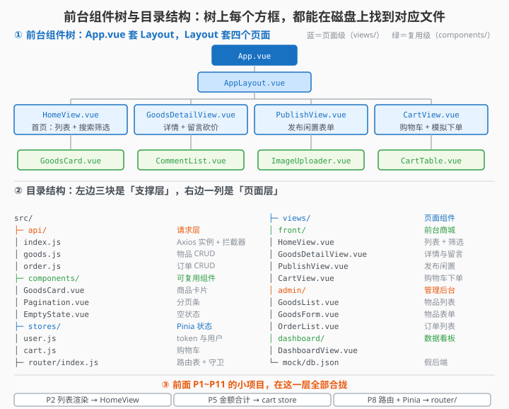

# 12.2 项目搭建与目录结构

> 章节：第 12 章 综合项目：「Campus2Hand」校园二手集市
> 课时：0.5 课时

---

## 🎯 学习目标

学完这节，你将能够：

- ✅ **掌握**：用 Vite 脚手架创建 Vue 3 项目
- ✅ **配置**：ESLint + Prettier 代码规范
- ✅ **理解**：校园二手集市项目的完整目录结构
- ✅ **安装**：Element Plus、Axios、Vue Router、Pinia 依赖

---

## 🧠 思维导图

```text
12.2 项目搭建与目录结构
├── 创建项目
│   ├── npm create vite@latest
│   └── 选择 Vue + JavaScript
├── 安装依赖
│   ├── vue-router / pinia / axios / element-plus
│   └── 开发依赖：eslint / prettier / sass（可选）
├── 目录结构
│   ├── src/
│   │   ├── api/        → Axios 请求封装
│   │   ├── assets/     → 静态资源
│   │   ├── components/ → 公共组件
│   │   ├── router/     → 路由配置
│   │   ├── stores/     → Pinia 状态
│   │   ├── views/      → 页面组件
│   │   ├── utils/      → 工具函数
│   │   ├── App.vue
│   │   └── main.js
│   ├── public/
│   ├── .env.development / .env.production
│   ├── vite.config.js
│   └── eslint.config.js
└── Element Plus 按需引入
```

需求蓝图已画好，这节真正把项目"立"起来：用 Vite 一行命令创建 `admin-system`，装齐 Router / Pinia / Axios / Element Plus / ECharts，把 `src` 下 `api / components / stores / views` 的分工讲清楚，再配好 `main.js` 注册、`@` 别名和 `.env` 环境变量——地基打牢，后面 12 节才能在干净的骨架上逐个模块添砖加瓦。

> 🎯 **类比一下：项目搭建 ≈ 盖楼先打地基和立框架**
> 没人会先贴墙纸再浇地基——盖楼的第一天一定在做两件事：**打好地基**（依赖装齐、环境变量配好）和**立起框架**（`src` 下的 `api / components / stores / views` 分工）。框架立对了，后面每个模块都是"往对应格子里放东西"；框架乱搭，越写越像盘根错节的毛线团。本节就是帮你把"毛坯房"的格局一次定对。

> 🧑 **小白**：Vite 和 Webpack 都是打包的，为什么教程选 Vite？
> 🤖 **Vue 君**：Vite 开发模式**按需编译**——用到哪个文件才编译哪个，启动 2 秒内；Webpack 要把所有文件打包完才启动，动辄 30 秒。写代码等启动是种折磨，Vite 把折磨去掉了。
> 👨🏫 **老湿**：**目录结构不是摆设，是团队的"口头协议"**：`api` 放请求、`stores` 放状态、`views` 放页面——看到路径就知道去哪找代码。面试时讲清"为什么这样分层"，比背十道八股更有说服力。

---




## 🤔 一、Vite 创建项目——为什么这么快？

Vite 的开发服务器基于浏览器原生 ES Module，不需要像 Webpack 那样把所有文件打包再启动，所以：

- **Webpack**：启动 → 打包所有文件 → 启动服务器（等 30 秒）→ 打开浏览器
- **Vite**：启动 → 打开浏览器 → 用到了哪个文件才编译哪个（2 秒内）

```bash
# 第一步：创建项目
npm create vite@latest admin-system -- --template vue

# 第二步：进入项目目录
cd admin-system

# 第三步：安装基础依赖
npm install

# 第四步：启动开发服务器
npm run dev
```

浏览器打开 `http://localhost:5173`，看到 Vite + Vue 的欢迎页，项目就跑起来了。

---

## 💡 二、安装项目依赖

### 2.1 核心依赖

```bash
# 路由
npm install vue-router@5

# 状态管理
npm install pinia

# HTTP 请求
npm install axios

# UI 组件库
npm install element-plus

# ECharts（12.17 数据看板用）
npm install echarts
```

### 2.2 开发依赖

```bash
# ESLint + Prettier
npm install -D eslint @eslint/js eslint-plugin-vue prettier
```

### 2.3 package.json 核心字段

```json
{
  "name": "admin-system",
  "private": true,
  "version": "1.0.0",
  "type": "module",
  "scripts": {
    "dev": "vite",
    "build": "vite build",
    "preview": "vite preview",
    "lint": "eslint . --fix"
  },
  "dependencies": {
    "axios": "^1.7.0",
    "echarts": "^6.0.0",
    "element-plus": "^2.8.0",
    "pinia": "^4.0.0",
    "vue": "^3.5.0",
    "vue-router": "^5.0.0"
  }
}
```

---

## 🛠 三、目录结构——每个文件夹是干什么的？

一个规范的项目目录结构，能让你半年后回来还能迅速定位代码。下面是本项目使用的目录：

```text
admin-system/
├── public/              # 不经过编译的静态文件（favicon 等）
│   └── favicon.ico
├── src/
│   ├── api/             # 🔴 Axios 请求封装（每个模块一个 .js）
│   │   ├── index.js     #    创建 axios 实例 + 拦截器
│   │   ├── auth.js      #    登录/注册相关接口
│   │   ├── goods.js     #    闲置物品相关接口
│   │   └── order.js     #    交易订单相关接口
│   │
│   ├── assets/          # 静态资源（图片、样式）
│   │   └── logo.svg
│   │
│   ├── components/      # 🔴 公共组件（复用）
│   │   ├── AppLayout.vue    # 管理后台布局（侧边栏 + 顶栏 + 内容区）
│   │   └── Pagination.vue   # 通用分页组件（可选）
│   │
│   ├── router/          # 🔴 路由配置
│   │   └── index.js     #    路由表 + 守卫
│   │
│   ├── stores/          # 🔴 Pinia 状态管理
│   │   ├── user.js      #    用户状态（token、用户信息）
│   │   └── app.js       #    应用状态（侧边栏折叠等）
│   │
│   ├── utils/           # 工具函数
│   │   └── request.js   #    Axios 实例（也可放 api/ 目录）
│   │
│   ├── views/           # 🔴 页面级组件（每个路由对应一个）
│   │   ├── login/       #    登录页
│   │   │   └── LoginView.vue
│   │   ├── front/       # ⭐ 前台商城（公开页面，12.4~12.10）
│   │   │   ├── HomeView.vue            #   12.4 首页：闲置列表+搜索筛选
│   │   │   ├── GoodsDetailView.vue     #   12.5 商品详情与留言
│   │   │   ├── PublishView.vue         #   12.9 发布闲置
│   │   │   └── CartView.vue            #   12.10 购物车与下单
│   │   ├── admin/       # ⭐ 管理后台（12.11~12.16）
│   │   │   ├── GoodsList.vue           #   12.11 闲置物品列表页
│   │   │   ├── GoodsForm.vue           #   12.12 新增/编辑表单页
│   │   │   ├── OrderList.vue           #   12.14 订单列表页
│   │   │   └── OrderDetailDialog.vue   #   12.15 订单详情弹窗
│   │   └── dashboard/   # 数据看板（12.17）
│   │       └── DashboardView.vue
│   │
│   ├── mock/           # 🔴 本地假数据（让项目不依赖真实后端）
│   │   ├── db.js       #    内存数据库（商品/订单/用户）
│   │   └── server.js   #    模拟网络延迟与异常
│   │
│   ├── App.vue          # 根组件
│   └── main.js          # 入口文件
│
├── .env.development     # 开发环境变量
├── .env.production      # 生产环境变量
├── eslint.config.js     # ESLint 配置
├── vite.config.js       # Vite 配置
├── package.json
└── index.html           # HTML 入口
```

### 目录设计原则

| 目录 | 放什么 | 不放什么 |
|---|---|---|
| `api/` | 各模块的接口函数 | 组件、工具函数 |
| `components/` | **可复用**的组件 | 页面级组件（进 `views/`） |
| `views/` | 页面级组件 | 可复用组件 |
| `stores/` | Pinia store | 普通工具函数 |
| `utils/` | 通用工具函数 | 业务逻辑 |

> 💬 **老师备注**：初学者最容易犯的错误是 `components/` 和 `views/` 不分。记住一个简单判断：**这个组件是不是被多个页面使用？** 是 → `components/`；否 → `views/`。

---

## 🧪 四、mock 方案：没有后端怎么跑起来？（⭐ 必读）

**这是本章能不能"跑通"的关键。** 后台六节（12.11~12.16）全都要请求接口，如果你手上没有真实后端，就会卡在第一步——所有页面都是空白 + 控制台一堆报错。

**解法**：用 `json-server` 在本地跑一个假后端。**30 行代码，你不用写任何后端代码。**

### 4.1 安装并启动

```bash
npm install -D json-server
```

新建 `db.json`（项目根目录）：

```json
{
  "goods": [
    { "id": 1, "title": "九成新自行车", "price": 350, "category": "运动出行", "status": "on_sale", "seller": "张三", "createdAt": "2026-10-01" },
    { "id": 2, "title": "考研全套教材", "price": 60, "category": "书籍教材", "status": "on_sale", "seller": "李四", "createdAt": "2026-10-03" },
    { "id": 3, "title": "机械键盘 87 键", "price": 220, "category": "数码电子", "status": "sold", "seller": "王五", "createdAt": "2026-09-28" },
    { "id": 4, "title": "折叠桌板", "price": 45, "category": "生活家居", "status": "on_sale", "seller": "赵六", "createdAt": "2026-10-05" }
  ],
  "orders": [
    { "id": 1, "goodsId": 1, "buyer": "小明", "amount": 350, "status": "pending", "createdAt": "2026-10-08" },
    { "id": 2, "goodsId": 2, "buyer": "小红", "amount": 60, "status": "shipped", "createdAt": "2026-10-07" }
  ],
  "users": [
    { "id": 1, "username": "admin", "password": "123456", "role": "admin" }
  ]
}
```

启动（**另开一个终端**，让这个进程一直跑着）：

```bash
npx json-server --watch db.json --port 3000
```

### 4.2 vite.config.js 里配代理

```js
export default defineConfig({
  plugins: [vue()],
  resolve: { alias: { '@': fileURLToPath(new URL('./src', import.meta.url)) } },
  server: {
    proxy: {
      // 把前端的 /api/xxx 转给本地 json-server
      // 这样前端代码里一直写 /api/goods，切换后端时不用改代码
      '/api': {
        target: 'http://localhost:3000',
        changeOrigin: true,
        rewrite: p => p.replace(/^\/api/, '')   // 去掉 /api 前缀
      }
    }
  }
})
```

### 4.3 json-server 自带的接口

| 你想要 | 直接调 |
|---|---|
| 商品列表 | `GET /api/goods` |
| 分页 | `GET /api/goods?_page=1&_limit=10`（返回 `X-Total-Count` 头） |
| 搜索 | `GET /api/goods?title=自行车` |
| 详情 | `GET /api/goods/1` |
| 新增 | `POST /api/goods`（body 直接就是商品对象） |
| 编辑 | `PUT /api/goods/1` |
| 删除 | `DELETE /api/goods/1` |

> 💬 **老师备注：为什么一定要先搭 mock？**
> 因为**前端调试的最大成本不是写代码，是等接口**。有了 mock，你可以：
> - 12.11~12.16 每一节都能**立刻跑起来看到效果**，不用等后端同学
> - 专注于「分页三状态、loading 骨架、空状态」这些**真正的难点**
> - 后端写好后，只要改 `.env.development` 里的 `VITE_API_BASE_URL` 就能切换，**前端代码一行不用动**
>
> 这就是**为什么要把接口地址抽成环境变量**——它不只是"部署要用"，更是"开发时方便换后端"。

### 4.4 数据契约表（⭐ 后续所有节都按这张表写）

**这是本项目的"接口文档"。** 从 12.4 到 12.17，所有代码里的字段名都以此为准，**不要中途改字段名**：

**商品 goods**
| 字段 | 类型 | 说明 |
|---|---|---|
| `id` | number | 主键，新增时由 json-server 自动生成 |
| `title` | string | 商品名称 |
| `price` | number | 价格（元） |
| `category` | string | 分类：书籍教材 / 数码电子 / 生活家居 / 运动出行 |
| `status` | string | `on_sale` 在售 / `sold` 已售 / `off_shelf` 已下架 |
| `seller` | string | 卖家昵称 |
| `createdAt` | string | 创建日期 `YYYY-MM-DD` |

**订单 orders**
| 字段 | 类型 | 说明 |
|---|---|---|
| `id` | number | 主键 |
| `goodsId` | number | 对应商品 id |
| `buyer` | string | 买家昵称 |
| `amount` | number | 成交金额 |
| `status` | string | `pending` 待付款 / `paid` 已付款 / `shipped` 已发货 / `completed` 已完成 / `cancelled` 已取消 |
| `createdAt` | string | 下单日期 |

> ⚠️ **状态值统一用英文下划线小写**，不要一会儿 `on_sale` 一会儿 `ON_SALE`。中文用 `el-tag` 的 `label` 映射表转（12.15 会写这个映射表），**数据和展示分离**——这样以后要改文案不用动数据。

---

## 🔑 四、关键配置文件

### 4.1 main.js —— 项目入口

```js
// src/main.js
import { createApp } from 'vue'
import { createPinia } from 'pinia'
import ElementPlus from 'element-plus'
import 'element-plus/dist/index.css'
import App from './App.vue'
import router from './router'

const app = createApp(App)

app.use(createPinia())      // Pinia 状态管理
app.use(router)             // Vue Router
app.use(ElementPlus)        // Element Plus UI 库

app.mount('#app')
```

### 4.2 vite.config.js —— Vite 配置

```js
// vite.config.js
import { defineConfig } from 'vite'
import vue from '@vitejs/plugin-vue'
import { fileURLToPath, URL } from 'node:url'

export default defineConfig({
  plugins: [vue()],
  resolve: {
    alias: {
      // ⚠️ 不能用 __dirname —— 本项目是 ESM（package.json 里有 "type": "module"），
      //    __dirname 是 CommonJS 才有的变量，写了会直接报 ReferenceError。
      //    Vue 官方模板的做法是用 import.meta.url 转一下。
      '@': fileURLToPath(new URL('./src', import.meta.url))   // @ 指向 src 目录
    }
  },
  server: {
    port: 5173,
    proxy: {
      // 将 /api 开头的请求转发到后端
      '/api': {
        target: 'http://localhost:3000',
        changeOrigin: true
      }
    }
  }
})
```

> 💬 **老师备注**：`@` 别名让你可以用 `@/api/auth.js` 代替 `../../../api/auth.js`，在复杂项目中非常实用。

### 4.3 .env 环境变量

```bash
# .env.development（开发环境）
VITE_API_BASE_URL=http://localhost:3000/api

# .env.production（生产环境）
VITE_API_BASE_URL=https://your-server.com/api
```

在代码中使用：

```js
// 自动根据运行模式读取对应的 .env 文件
const baseURL = import.meta.env.VITE_API_BASE_URL
```

---

## ⚠️ 五、常见陷阱

### 陷阱 1：import 路径写错

```js
// ❌ Vite 默认不解析 @ 别名
import Header from '@/components/Header.vue'
```

必须在 `vite.config.js` 中配置 `resolve.alias`，否则 `@` 不生效。

### 陷阱 2：Element Plus 样式没引入

```js
// ❌ 只引入组件，没引入样式 → 页面乱掉
import ElementPlus from 'element-plus'
app.use(ElementPlus)
```

必须同时引入样式：

```js
import 'element-plus/dist/index.css'  // ← 这一行不能少
```

### 陷阱 3：Node 版本太低（最常见的一坑）

Vite 8 要求 **Node.js ≥ 20.19或 22.12+**，而 `create-vue` 要求更严：**^22.18.0 或 ≥24.12.0**。版本太低时，`npm create` 或 `npm install` 会直接报错。

```bash
# 检查 Node 版本
node -v
# 期望：v22.18.x 或更高（v24.x.x 也可以）
```

**如果你已经装了 Node 18**（很多老项目的默认版本），用 nvm 升级——注意是**升级**到 22，不是固定在 18：

```bash
# 装 nvm（macOS/Linux）
curl -o- https://raw.githubusercontent.com/nvm-sh/nvm/v0.40.1/install.sh | bash

# ✅ 装并切到 22 LTS
nvm install 22
nvm use 22

# ❌ 不要这样做：nvm install 18 —— 这正是被禁的版本
nvm use 22 && node -v   # 确认输出 v22.x.x
```

> ⚠️ **别照抄 `nvm install 18`**。这类"老教程"的命令在网络教程里到处都是，但 Vite 8 已经不支持它了。**看到和本书版本不符的旧命令，一律以本书为准。**

### 陷阱 4：`__dirname` 在 ESM 项目里不存在

```js
// ❌ 启动直接报 ReferenceError: __dirname is not defined
import { fileURLToPath, URL } from 'node:url'
resolve: { '@': fileURLToPath(new URL('./src', import.meta.url)) }
```

Vite 创建的项目在 `package.json` 里带了 `"type": "module"`，整个项目按 **ESM** 运行——而 `__dirname` 是 **CommonJS** 才有的变量。

**Vue 官方推荐用 `import.meta.url` 替代**（新版 create-vue 模板就是这么生成的）：

```js
// vite.config.js —— 正确的写法
import { defineConfig } from 'vite'
import vue from '@vitejs/plugin-vue'
import { fileURLToPath, URL } from 'node:url'

export default defineConfig({
  plugins: [vue()],
  resolve: {
    // fileURLToPath + URL 把 import.meta.url 转成文件系统路径，等价于 __dirname 的效果
    alias: { '@': fileURLToPath(new URL('./src', import.meta.url)) }
  },
  server: {
    proxy: {
      '/api': { target: 'http://localhost:3000', changeOrigin: true }
    }
  }
})
```

---

## 📝 即时练习

**练习 1**：用 Vite 创建一个新项目 `my-admin`，安装本节列出的所有依赖，启动开发服务器，确认 Element Plus 的 `<el-button>` 组件能正常渲染。

**练习 2**：按照本节给出的目录结构，在 `src/` 下创建所有子目录（`api/`、`components/`、`stores/` 等），并在 `main.js` 中完成 Pinia、Router、Element Plus 的注册。

**练习 3**：配置 `vite.config.js` 的 `@` 别名，然后尝试在 `App.vue` 中用 `@/components/AppLayout.vue` 引入一个组件，验证别名是否生效。

---

## 🧠 本节小结

- **创建项目**：`npm create vite@latest admin-system -- --template vue` → `npm i` → `npm run dev`；Vite 基于原生 ESM 按需编译，启动秒级（Webpack 需全量打包）
- **依赖分工**：运行时 `vue-router@5 / pinia / axios / element-plus / echarts`，开发时 `eslint / prettier`；Node 版本要 20.19+
- **目录规范**：`api/` 放接口函数、`components/` 放可复用组件、`views/` 放页面级组件、`stores/` 放 Pinia、`utils/` 放工具函数——判断标准："是否被多个页面使用"
- **main.js 注册**：`createPinia` / `router` / `ElementPlus` 依次 `app.use`，别忘了引入 `element-plus/dist/index.css`
- **vite.config.js**：配置 `@` → `src` 别名（否则 `@/...` import 不生效）；`/api` proxy 转发后端
- **环境变量**：`.env.development` / `.env.production` 分别配 `VITE_API_BASE_URL`，代码里用 `import.meta.env.VITE_API_BASE_URL` 读取

---

## 🔥 冷知识 / 小灶

- **Vite 名字来自法语 "Vite"，意思就是"快"**——作者尤雨溪（Vue 之父）嫌 Webpack 开发体验太慢，2019 年用浏览器原生 ESM 重新设计了开发服务器：启动不用先打包全部文件，谁用到了谁编译，于是"快到秒级"。

<details>
<summary>💡 深究一下：为什么"分层目录"是团队的隐形约定？</summary>

目录结构不是强迫症，它解决的是**"代码该去哪找"**的问题：

```text
api/         → 网络请求，改接口只进这一个目录
components/  → 可复用 UI，与业务无关的零件
views/       → 页面级组件，路由直接指向这里
stores/      → 全局状态，跨页面共享的数据
utils/       → 纯函数工具，不依赖 Vue
```

判断标准就一句话：**"这个文件会被多个页面用到吗？"** 会 → 下沉到 `components` / `stores` / `utils`；不会 → 留在 `views` 里。大项目里新人接手时，光看目录就能猜出八成代码逻辑——这就是"可维护性"的起点。

</details>

---

## 📚 拓展阅读

- [Vite 官方文档 - 开始](https://cn.vitejs.dev/guide/)
- [Element Plus 快速上手](https://element-plus.org/zh-CN/guide/quickstart.html)
- [Vite 环境变量与模式](https://cn.vitejs.dev/guide/env-and-mode.html)

---

**（12.2 节结束，下一节 12.3 讲路由设计与权限控制 →）**
