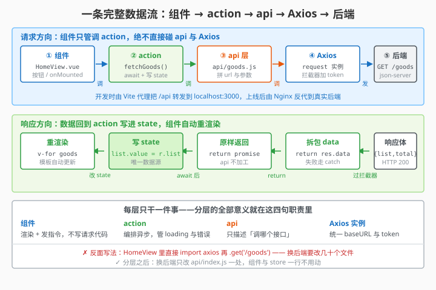

# 12.3 路由设计与权限控制

> 章节：第 12 章 综合项目：「Campus2Hand」校园二手集市
> 课时：0.5 课时

---

## 🎯 学习目标

学完这节，你将能够：

- ✅ **设计**：校园二手集市的完整路由表
- ✅ **实现**：路由守卫实现登录拦截
- ✅ **理解**：动态路由和权限控制的基本思路
- ✅ **处理**：404 页面和通配符路由

---

## 🧠 思维导图

```text
12.3 路由设计与权限控制
├── 路由表设计
│   ├── /login          → 登录页（公开）
│   ├── /               → 重定向到 /dashboard
│   ├── /dashboard      → 数据看板（需登录）
│   ├── /goods          → 闲置物品列表（需登录）
│   ├── /goods/add      → 新增闲置物品
│   ├── /goods/edit/:id → 编辑闲置物品
│   └── /orders         → 交易订单管理（需登录）
├── 路由守卫（beforeEach）
│   ├── 白名单：/login（无需登录）
│   ├── 检查 token：无 token → 跳转 /login
│   └── 有 token → 放行
├── 动态路由
│   ├── router.addRoute() 动态添加
│   └── 根据用户角色加载不同路由
└── 404 处理
    ├── /:pathMatch(.*)*  通配符
    └── NotFound.vue 组件
```

项目骨架搭好，但管理后台有个关键特性：除 `/login` 外所有页面都要登录才能进。12.2 的 `router` 只是空注册，这节把它变成"门禁系统"——先设计功能导向的路由表，再用 `beforeEach` 守卫做登录拦截（带 `redirect` 回跳细节），最后补上 404 兜底和"不同角色看不同菜单"的动态路由进阶思路。

> 🎯 **类比一下：路由守卫 ≈ 写字楼的门禁系统**
> 写字楼不是所有楼层随便进：一楼大厅（`/login`）人人可进，办公区要刷工牌（token），没卡的人一到闸机就被拦住、请去前台登记（跳回登录页），刷完卡还能记住你要去几楼（`redirect` 回跳）。路由守卫 `beforeEach` 就是这道"闸机"——每个请求进来先查"你有没有工牌"，没有就拦截。

> 🧑 **小白**：每个页面都要手动判断登录吗？那不是写很多重复代码？
> 🤖 **Vue 君**：不用！守卫是"全局闸机"——在 `beforeEach` 里写一次，**所有路由跳转自动过闸**。配一个白名单（如 `/login`），白名单外没 token 一律拦下跳登录。
> 👨🏫 **老湿**：**别把 token 校验写在每个页面里**——那是"每层楼自己设岗"，漏一层就漏一片。全局守卫 + 白名单是管理后台的标准姿势；动态路由（按角色 `addRoute`）是进阶加分项，面试常聊。

---

## 🤔 一、管理后台路由长什么样？

管理后台和普通网站的路由结构不同。普通网站的路由可能是：

```text
/           → 首页
/about      → 关于
/products/1 → 闲置物品详情
```

而管理后台的路由是**功能导向**的：

```text
/login      → 登录（唯一个公开页面）
/dashboard  → 首页看板
/goods      → 闲置物品列表
/goods/add  → 新增闲置物品
/goods/3    → 编辑第 3 号闲置物品
/orders     → 交易订单列表
```

你会发现：除了 `/login`，所有页面都需要登录才能访问。这就是**路由守卫**要干的事。

---




## 💡 二、完整路由表代码

```js
// src/router/index.js
import { createRouter, createWebHistory } from 'vue-router'
import { useUserStore } from '@/stores/user'

const routes = [
  // ==================== 公开路由（任何人可访问） ====================
  {
    path: '/login',
    name: 'login',
    component: () => import('@/views/login/LoginView.vue'),
    meta: { title: '登录', requiresAuth: false }
  },

  // ==================== 前台路由（游客可看，登录后可操作） ====================
  // ⚠️ 注意：这里的「前台首页」是 /home，不是 /dashboard。
  // '/' 必须 redirect 到 /home，否则会「吃掉」前台首页（见下方说明）
  {
    path: '/',
    redirect: '/home'
  },
  {
    path: '/home',
    name: 'home',
    component: () => import('@/views/front/HomeView.vue'),
    meta: { title: '校园集市', requiresAuth: false }
  },
  {
    path: '/goods/:id',
    name: 'goods-detail',
    component: () => import('@/views/front/GoodsDetailView.vue'),
    meta: { title: '商品详情', requiresAuth: false }
  },
  {
    path: '/publish',
    name: 'publish',
    component: () => import('@/views/front/PublishView.vue'),
    meta: { title: '发布闲置', requiresAuth: true }
  },
  {
    path: '/cart',
    name: 'cart',
    component: () => import('@/views/front/CartView.vue'),
    meta: { title: '购物车', requiresAuth: true }
  },

  // ==================== 后台路由（需登录） ====================
  {
    path: '/dashboard',
    name: 'dashboard',
    component: () => import('@/views/dashboard/DashboardView.vue'),
    meta: { title: '数据看板', requiresAuth: true }
  },
  {
    path: '/goods',
    name: 'goods',
    component: () => import('@/views/admin/GoodsList.vue'),
    meta: { title: '闲置物品管理', requiresAuth: true }
  },
  {
    path: '/goods/add',
    name: 'goods-add',
    component: () => import('@/views/admin/GoodsForm.vue'),
    meta: { title: '新增闲置物品', requiresAuth: true }
  },
  {
    path: '/goods/edit/:id',
    name: 'goods-edit',
    component: () => import('@/views/admin/GoodsForm.vue'),
    meta: { title: '编辑闲置物品', requiresAuth: true }
  },
  {
    path: '/orders',
    name: 'orders',
    component: () => import('@/views/admin/OrderList.vue'),
    meta: { title: '交易订单管理', requiresAuth: true }
  },

  // ==================== 404 兜底（必须放最后） ====================
  {
    path: '/:pathMatch(.*)*',
    name: 'not-found',
    component: () => import('@/views/NotFound.vue'),
    meta: { title: '404', requiresAuth: false }
  }
]

const router = createRouter({
  history: createWebHistory(),
  routes
})

export default router
```

### ⚠️ 本节的路由表是「终版」，后面不再改

这张表覆盖了**全书 12.4~12.17 所有页面**。请对照确认：

| 章节 | 页面 | 路由 | 组件路径 | 需要登录 |
|---|---|---|---|---|
| 12.4 | 前台首页（闲置列表+搜索筛选） | `/home` | `views/front/HomeView.vue` | 否 |
| 12.5 | 商品详情与留言 | `/goods/:id` | `views/front/GoodsDetailView.vue` | 否 |
| 12.7 | 登录页 | `/login` | `views/login/LoginView.vue` | 否 |
| 12.9 | 发布闲置 | `/publish` | `views/front/PublishView.vue` | **是** |
| 12.10 | 购物车与下单 | `/cart` | `views/front/CartView.vue` | **是** |
| 12.11~12.13 | 闲置物品管理 | `/goods`、`/goods/add`、`/goods/edit/:id` | `views/admin/Goods*.vue` | **是** |
| 12.14~12.16 | 交易订单管理 | `/orders` | `views/admin/Order*.vue` | **是** |
| 12.17 | 数据看板 | `/dashboard` | `views/dashboard/DashboardView.vue` | **是** |

**目录约定**：前台页面放 `views/front/`，后台页面放 `views/admin/`。两套布局（前台商城 / 后台管理）通过父级路由的 `children` 区分，12.2 已给出目录结构。

> 💬 **老师备注：为什么 `/` 不能 redirect 到 `/dashboard`？**
> `/dashboard` 是**后台**页面，需要登录。如果你这样写：
> ```js
> { path: '/', redirect: '/dashboard' }
> ```
> 那么游客访问网站根路径 → 被弹到登录页，**他连商品列表都看不到**。而项目首页应该是游客也能逛的 `/home`。
> 判断标准：**根路径要指向「这个网站是干什么的」那个页面。** 二手集市显然先给人看商品，不是先给人看报表。

### 关键设计说明

| 设计点 | 说明 |
|---|---|
| `() => import(...)` | **懒加载**：只有访问该路由时才加载对应组件，减小首屏体积 |
| `meta.requiresAuth` | 标记是否需要登录，守卫里统一判断 |
| `meta.title` | 页面标题，可用于设置 `document.title` |
| `/goods/add` 和 `/goods/edit/:id` | 共用同一个组件 `GoodsForm.vue`，通过路由参数区分新增/编辑 |
| `/:pathMatch(.*)*` | Vue Router 的通配符语法（`.*` 表示任意层级路径），匹配所有未定义路径。**必须放在数组最后**，否则后面的路由都匹配不到 |

---

## 🔑 三、路由守卫——登录拦截的核心

路由守卫（Navigation Guard）在每次路由跳转前执行，检查用户是否登录。

```js
// 在 src/router/index.js 末尾追加守卫代码

import { useUserStore } from '@/stores/user'

router.beforeEach((to, from, next) => {
  const userStore = useUserStore()

  // 1. 设置页面标题
  document.title = to.meta.title ? `${to.meta.title} - 管理后台` : '管理后台'

  // 2. 如果目标路由不需要登录 → 直接放行
  if (!to.meta.requiresAuth) {
    return next()
  }

  // 3. 需要登录但用户没有 token → 跳转到登录页
  if (!userStore.token) {
    return next({ path: '/login', query: { redirect: to.fullPath } })
  }

  // 4. 已登录 → 放行
  next()
})
```

### 守卫流程图

```text
用户访问 /goods
  → beforeEach 触发
  → meta.requiresAuth 是 true ?
      ├── 否 → 直接放行
      └── 是 → 有 token ?
          ├── 否 → 跳转 /login（带上 redirect 参数）
          └── 是 → 放行
```

### redirect 参数的作用

登录成功后可以跳回用户原本想去的地方：

```js
// LoginView.vue 登录成功后
const router = useRouter()
const route = useRoute()

// 登录成功后跳回原页面
const redirect = route.query.redirect || '/dashboard'
router.push(redirect)
```

> 💬 **老师备注**：`redirect` 参数是一个很好的用户体验细节。用户本来想访问 `/goods`，被拦到登录页，登录后直接跳到 `/goods`，而不是跳到首页让用户再点一次。面试时提到这个细节，面试官会对你印象加分。

---

## 🛠 四、404 页面处理

当用户访问不存在的路径时（如 `/abc`），应该显示一个友好的 404 页面：

```vue
<!-- src/views/NotFound.vue -->
<script setup>
import { useRouter } from 'vue-router'
const router = useRouter()
</script>

<template>
  <div class="not-found">
    <h1>404</h1>
    <p>抱歉，您访问的页面不存在</p>
    <el-button type="primary" @click="router.push('/dashboard')">
      返回首页
    </el-button>
  </div>
</template>

<style scoped>
.not-found {
  display: flex;
  flex-direction: column;
  align-items: center;
  justify-content: center;
  height: 100vh;
}
.not-found h1 {
  font-size: 72px;
  color: #909399;
}
</style>
```

---

## 🔧 五、进阶：动态路由（权限控制）

前面我们把所有路由都写死在 `routes` 数组里，这适合**所有已登录用户看到相同的菜单**。

但如果需要**不同角色看不同菜单**（比如普通用户看不到"用户管理"），就需要动态路由：

```js
// 动态路由表（按角色）
const adminRoutes = [
  { path: '/users', component: () => import('@/views/user/UserList.vue') },
  { path: '/settings', component: () => import('@/views/Settings.vue') }
]

// 登录后根据角色动态添加
router.beforeEach((to, from, next) => {
  const userStore = useUserStore()
  if (userStore.token && userStore.role === 'admin') {
    // 用 addRoute 动态注册
    adminRoutes.forEach(r => router.addRoute(r))
  }
  next()
})
```

**本项目不强制要求动态路由**——因为是课设级别，先做到"所有已登录用户看到相同菜单"即可。这个知识点你了解就行，面试时可以说"我们项目用静态路由表，但我了解动态路由的实现方式"。

---

## ⚠️ 六、常见陷阱

### 陷阱 1：守卫里用 `pinia` 报错

```js
// ❌ 在 createRouter 之前调用 useUserStore()
const userStore = useUserStore()
```

Pinia 必须在 `app.use(createPinia())` 之后才能使用。但 `router/index.js` 在 `main.js` 里被 import 时，Pinia 还没安装。

**正确做法**：在 `beforeEach` 回调**里面**调用 `useUserStore()`——因为路由守卫是在应用启动后才触发的，此时 Pinia 已经就绪。

### 陷阱 2：`next()` 调用两次

```js
// ❌ 错误写法
router.beforeEach((to, from, next) => {
  if (!userStore.token) {
    next('/login')
  }
  next()  // ← 这里又调用了一次！
})
```

`next()` 只能调用一次，否则会报错。用 `return next()` 可以避免这种问题。

### 陷阱 3：404 路由位置不对

```js
// ❌ 把通配符路由放在最前面 → 所有路径都被拦截
const routes = [
  { path: '/:pathMatch(.*)*', component: NotFound },  // ← 不要放第一个
  { path: '/login', component: Login }
]
```

通配符路由必须放在路由数组的**最后**，Vue Router 按顺序匹配，匹配到第一个就停。

---

## 📝 即时练习

**练习 1**：补全 `LoginView.vue` 中登录成功后的跳转逻辑，支持 `redirect` 参数。

**练习 2**：在 `router/index.js` 中新增一个 `/profile` 路由（个人信息页），设置为需登录，测试未登录访问 `/profile` 是否正确跳转到 `/login`。

**练习 3**：把 404 页面做得更好看一些——加一个倒计时 3 秒自动跳回首页的效果（提示：`setTimeout` + `router.push`）。

---

## 🧠 本节小结

- **管理后台路由是功能导向**：除 `/login` 公开外，`/dashboard` `/goods` `/orders` 等都需登录；`/goods/add` 与 `/goods/edit/:id` 共用 `GoodsForm.vue`，靠参数区分新增/编辑
- **路由表设计要点**：`() => import(...)` 懒加载减首屏、`meta.requiresAuth` 标记权限、`meta.title` 设页面标题、`/:pathMatch(.*)*` 404 通配符必须放路由数组**最后**
- **守卫拦截**：`beforeEach` 内（而非文件顶层）调用 `useUserStore()`——Pinia 此时才就绪；无 token 跳 `/login` 并带 `query.redirect`，登录后跳回原页面
- **next 只调一次**：`if 分支 next('/login')` 后别再写裸 `next()`；用 `return next()` 收口避免二次调用报错
- **动态路由进阶**：不同角色看不同菜单用 `router.addRoute()` 按角色追加；本项目课设先做"登录即可见全部菜单"，了解实现即可

---

## 🔥 冷知识 / 小灶

- **Vue Router 的守卫其实有三层**：全局守卫（`beforeEach`）、路由级守卫（`beforeEnter`）、组件内守卫（`onBeforeRouteLeave`）。本项目只用全局一层就够，但真实的权限系统常组合使用——比如"编辑页离开前提示保存"就要用组件内守卫。

<details>
<summary>💡 深究一下：`beforeEach` 的标准骨架长什么样？</summary>

把 12.3 的守卫逻辑浓缩成骨架，就是下面这个"门禁模板"，任何项目都能套：

```js
router.beforeEach((to, from) => {
  // 白名单：不需要登录的页面
  if (to.meta.requiresAuth === false) return true

  const userStore = useUserStore()   // 在守卫内调用，Pinia 才就绪
  if (userStore.token) return true   // 已登录，放行

  // 未登录：记录要去哪，踢去登录页，登录后跳回
  return { path: '/login', query: { redirect: to.fullPath } }
})
```

三个关键点：**守卫内取 store**（文件顶层取会报 Pinia 未初始化）、**白名单放行**、**`redirect` 回跳**。这套骨架背下来，面试写权限系统手到擒来。

</details>

---

## 📚 拓展阅读

- [Vue Router 5 - 导航守卫](https://router.vuejs.org/zh/guide/advanced/navigation-guards.html)
- [Vue Router 5 - 动态路由](https://router.vuejs.org/zh/guide/advanced/dynamic-routing.html)
- [Vue Router 5 - 路由元信息](https://router.vuejs.org/zh/guide/advanced/meta.html)

---

**（12.3 节结束，下一节 12.4 讲前台首页：闲置列表与搜索筛选 →）**
